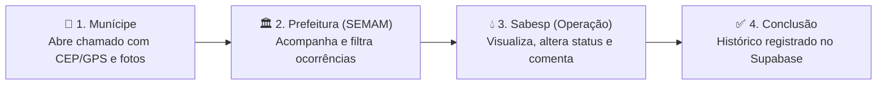

<h1 align="center">💧 Sabesp &amp; Prefeitura de Santos</h1>

  <b>Plataforma digital em Java Web (Spring Boot + Supabase) para registro, acompanhamento e fiscalização de ocorrências relacionadas à rede de esgoto e à recomposição de vias públicas em Santos (SP).</b>

  
  
  
  
  

  

> ℹ️ **Aviso de Natureza Acadêmica:**  
> Este é um projeto acadêmico independente desenvolvido para o Trabalho de Conclusão de Curso (TCC) no curso de **Tecnologia em Sistemas para Internet** da **Faculdade de Tecnologia da Baixada Santista Rubens Lara (FATEC Rubens Lara)**. A menção à Sabesp e à Prefeitura de Santos contextualiza o problema territorial estudado e os atores considerados na proposta; não implica parceria, vínculo institucional, aprovação ou integração oficial com esses órgãos. A aplicação não deve ser considerada um canal oficial de atendimento.

---

## 📌 Sobre o Projeto

O projeto implementa uma plataforma web para registrar, acompanhar e fiscalizar ocorrências relacionadas a vazamentos na rede de esgoto, refluxos, rompimentos de tubulação e tampas de bueiro danificadas no município de **Santos (SP)**.

A solução organiza o fluxo entre **munícipes**, **fiscalização municipal (`Sepref` / `Semam`)** e **operação da concessionária (`Sabesp`)**, reunindo informações do chamado, evidências fotográficas em nuvem, histórico de comentários, alterações de status e filtros operacionais por região e período.

### 🛠️ Stack Tecnológica Implementada

* **Backend & Web:** Java 17, Spring Boot 3.3.5 (Spring Web, Spring Data JPA, Thymeleaf, Bean Validation)
* **Banco de Dados em Nuvem:** PostgreSQL no **Supabase** (e H2 em memória para testes locais sem configuração externa)
* **Armazenamento de Fotos:** **Supabase Storage** (bucket `chamados-fotos` via REST API)
* **Geolocalização & Endereços:** ViaCEP (busca automática por CEP), Nominatim / OpenStreetMap (autocomplete de logradouros em Santos e geocodificação reversa via proxy no backend) e Geolocation API (GPS do navegador)
* **Deploy & Containerização:** Docker (`Dockerfile` multi-stage com Maven + Eclipse Temurin JRE 17) hospedado no **Render**

### 🎯 Objetivos da Proposta

* **Facilitar o registro de ocorrências** pelos munícipes por meio de interface responsiva, com busca por CEP, autocomplete em Santos, GPS e upload de até 5 fotos.
* **Melhorar a visibilidade do andamento dos chamados**, com geração automática de protocolo (`SAN-AAAA-XXXXXX`) e histórico cronológico de status e comentários.
* **Centralizar evidências e registros de fiscalização**, permitindo que a Prefeitura (SEMAM) acompanhe os chamados e realize filtros por Zona de Santos, Status, Período e busca textual.
* **Apoiar a operação da Sabesp**, oferecendo visualização completa das ocorrências (com galeria de fotos em destaque/Lightbox), alteração de status e registro de pareceres técnicos.

---

## 🧭 Como Explorar este Repositório

* 🎨 **[Explorar o Protótipo no Figma](https://www.figma.com/design/Tb4SDE9A4oEpLaXfN7aAhe/Projeto-%7C-Sabesp?node-id=0-1&t=yQExxpGpTtvoIWHk-1):** Conheça a proposta visual, sitemap, wireframes e fluxos interativos de uso.
* 📚 **[Consultar a Documentação Técnica (Docs Hub)](docs/README.md):** Requisitos (`MoSCoW`), modelo relacional, regras de negócio (`RBAC`) e marco legal de Santos.
* 🗺️ **[Acompanhar o Roadmap](#roadmap):** Veja o que já foi implementado no MVP e os próximos passos previstos no projeto.

---

## 📊 O Cenário Real em Números

Santos possui desafios de saneamento e zeladoria urbana que envolvem a manutenção da infraestrutura subterrânea histórica e consolidada do município, a fiscalização de prestadoras de serviço e a coordenação entre diferentes órgãos públicos:

* **Atendimento e Cobertura de Esgotamento:** Segundo o balanço municipal de saneamento referente ao período de 2020–2024 ([Prefeitura de Santos, 2026](https://www.santos.sp.gov.br/?q=node%2F170908)), o município registrou 98,43% de atendimento total de esgoto e 81,91% de tratamento total. Esses indicadores são distintos das metas e dos indicadores de coleta e tratamento descritos no [PMISB (Relatório R4)](https://www.santos.sp.gov.br/static/files_www/conteudo/13%20Anexo%205%20-%20Plano%20Municipal%20Integrado%20de%20Saneamento%20B%C3%A1sico.pdf). Para áreas de vulnerabilidade, destaca-se a iniciativa de regularização das ligações de água e esgoto no [Dique da Vila Gilda](https://www.santos.sp.gov.br/?q=noticia/parceria-garante-regularizacao-da-rede-de-agua-e-esgoto-para-a-vila-gilda-em-santos), com previsão de cerca de 2.500 ligações (2025–2026).
* **Prazo Legal para Recomposição Viária:** A legislação municipal ([Lei Complementar nº 852/2014](https://egov.santos.sp.gov.br/legis/documents/5195)) prevê prazo de 15 dias para a recomposição do pavimento nas situações e condições previstas na norma, contado conforme o marco legal aplicável (não se tratando de um tempo de atendimento operacional garantido pela concessionária).
* **Faixas de Acompanhamento na Ouvidoria:** O [SOM Web / 162](https://egov.santos.sp.gov.br/somweb/) apresenta categorias de ocorrências em tramitação por tempo decorrido, incluindo faixas de até 30 dias, de 31 a 60 dias e acima de 60 dias. ([Ver diagnóstico](docs/institucional/contexto-e-legislacao.md#descompasso-ouvidoria-prazos))
* **+190 Intimações em Balanço Oficial:** Volume registrado em balanço oficial da Prefeitura de Santos ([janeiro/2024](https://www.santos.sp.gov.br/?q=noticia/santos-aplica-197-intimacoes-e-notificacoes-a-prestadoras-de-servico-em-janeiro)), no qual a Secretaria de Prefeituras Regionais (Sepref) contabilizou 197 intimações e notificações a prestadoras de serviço (sendo 83 direcionadas à concessionária de saneamento).
* **Sanção Administrativa Ambiental (2023):** Multa de R$ 818 mil aplicada pela Secretaria Municipal de Meio Ambiente (SEMAM) em março de 2023 após vazamento que solapou a Rua Goiás ([Notícia Oficial PMS](https://www.santos.sp.gov.br/?q=noticia/santos-multa-sabesp-em-r-818-mil-reais-devido-a-contaminacao-de-solo-na-rua-goias) • [G1](https://g1.globo.com/sp/santos-regiao/noticia/2023/03/07/sabesp-e-multada-em-r-818-mil-apos-contaminacao-de-solo-na-rua-goias-em-santos-sp.ghtml)). A legislação municipal posterior ([Lei nº 4.525/2024](https://egov.santos.sp.gov.br/legis/documents/10840)) prevê, entre as fontes de recursos do Fundo Municipal de Saneamento Básico e Ambiental (FMSBA), sob controle social do [CMSBS](https://egov.santos.sp.gov.br/legis/documents/12103), receitas provenientes de multas e juros vinculados aos contratos e convênios especificados em seu artigo 4º, inciso VII.

> ⚠️ **Nota Metodológica:** Os dados acima são referências de contextualização territorial, não indicadores de desempenho da plataforma. A documentação reúne mais detalhes em [Contexto e Legislação](docs/institucional/contexto-e-legislacao.md).

---

## 💎 Perfis e Funcionalidades Implementadas

Atualmente, a tela inicial (`/`) permite selecionar diretamente o perfil de acesso para testes e validação dos fluxos:

| Perfil / Ator | Rota | O que já faz no sistema |
| :--- | :--- | :--- |
| **📱 Pessoa comum (Cidadão)** | `/chamados/novo` | Registra chamado com busca por **CEP (ViaCEP)**, **autocomplete de endereço em Santos**, **GPS**, seleção do tipo de problema, descrição e upload de **até 5 fotos (JPG/PNG)**, gerando protocolo `SAN-AAAA-XXXXXX`. |
| **💧 Sabesp (Operação)** | `/sabesp/chamados` | Visualiza o painel com KPIs, aplica filtros (Zona de Santos, Status, Período e busca), abre **fotos em destaque (Lightbox)** com setas de navegação, **altera o status** (`Pendente`, `Aprovado`, `Em Obra`, `Concluído`, `Rejeitado`) e **escreve comentários técnicos**. |
| **🏛️ Prefeitura (`SEMAM`)** | `/prefeitura/chamados` | Acompanha todos os chamados e realiza **filtros** por Zona de Santos, Status, Período e busca textual, com visualização de detalhes, fotos e histórico em **modo somente leitura**. |

### 🔄 Fluxo Operacional

---

## ⚙️ Estágio de Desenvolvimento das Funcionalidades

| Funcionalidade | Módulo / Perfil | Estágio Atual |
| :--- | :--- | :---: |
| Tela de seleção de perfil (Pessoa comum, Sabesp, Prefeitura) | Portal (`/`) | `Implementado` |
| Abertura de chamado com CEP automático, autocomplete, GPS e upload de até 5 fotos | Munícipe (`/chamados/novo`) | `Implementado` |
| Painel de chamados com KPIs e filtros (Zona de Santos, Status, Período, Busca) | Sabesp & Prefeitura | `Implementado` |
| Visualização de chamado com galeria de fotos em Lightbox (sem download) | Sabesp & Prefeitura | `Implementado` |
| Alteração de status da solicitação e registro de comentários técnicos | Sabesp (`/sabesp/chamados/{id}`) | `Implementado` |
| Persistência em nuvem (PostgreSQL + Storage) e deploy Docker | Supabase + Render | `Implementado` |
| Autenticação real (Login/Senha e controle de sessão por perfil) | Segurança (`RBAC`) | `Planejado (próxima etapa)` |
| Consulta pública de andamento por número de protocolo (*Stepper* visual) | Munícipe ("Minhas solicitações") | `Planejado (próxima etapa)` |

---

## 🚀 Como Executar o Projeto

### 1. Rodar localmente no Eclipse (Banco H2 em memória)
1. Importe o projeto via **File > Import > Maven > Existing Maven Projects**.
2. Execute `SaneamentoApplication.java` como **Java Application**.
3. Acesse `http://localhost:8080` (o sistema cria dados iniciais de exemplo automaticamente em memória).

### 2. Conectar ao Supabase (PostgreSQL + Storage)
1. No **SQL Editor** do Supabase, execute o script [`supabase-schema.sql`](supabase-schema.sql).
2. No menu **Storage**, crie um bucket público chamado `chamados-fotos`.
3. Configure as variáveis de ambiente listadas em [`.env.example`](.env.example) (`SPRING_PROFILES_ACTIVE=supabase`, `SUPABASE_DB_URL`, `SUPABASE_DB_USER`, `SUPABASE_DB_PASSWORD`, `SUPABASE_URL`, `SUPABASE_SERVICE_KEY`, `SUPABASE_STORAGE_BUCKET`) no Eclipse ou no serviço de hospedagem (**Render** via `Dockerfile`).

---

## 🌍 Compromisso com os Objetivos de Desenvolvimento Sustentável (ODS)

Este projeto está alinhado à **[Agenda 2030 da Organização das Nações Unidas (ONU)](https://brasil.un.org/pt-br/sdgs)**:

* **[ODS 6 · Água Potável e Saneamento](https://brasil.un.org/pt-br/sdgs/6):** Mitigação de impactos decorrentes de extravasamentos em canais de drenagem e praias de Santos.
* **[ODS 9 · Indústria, Inovação e Infraestrutura](https://brasil.un.org/pt-br/sdgs/9):** Modernização da gestão urbana por meio de esteira digital e processos rastreáveis.
* **[ODS 11 · Cidades e Comunidades Sustentáveis](https://brasil.un.org/pt-br/sdgs/11):** Apoio à resiliência urbana e suporte a áreas vulneráveis (Dique da Vila Gilda).
* **[ODS 16 · Paz, Justiça e Instituições Eficazes](https://brasil.un.org/pt-br/sdgs/16):** Transparência ativa e controle social sobre ocorrências de saneamento.

---

## 🧭 Central de Documentação (Docs Hub)

A documentação teórica e de engenharia do projeto está organizada no **[Portal da Documentação (docs/README.md)](docs/README.md)**:

| Categoria | Módulo | Foco & Conteúdo |
| :--- | :--- | :--- |
| 🏛️ **Institucional** | [**Contexto & Legislação**](docs/institucional/contexto-e-legislacao.md) | Diagnóstico territorial de Santos, concessão Sabesp (`LC 707`), caso Rua Goiás, Vila Gilda, `FMSBA` (`Lei 4.525`), `CMSBS` e `ODS`. |
| 🏛️ **Institucional** | [**Triagem Inteligente**](docs/institucional/triagem-inteligente.md) | Árvore de decisão lógica: segregação entre rede de esgoto (`Sabesp`) e drenagem pluvial (`Prefeitura / Seserp`). |
| 🏛️ **Institucional** | [**Glossário Terminológico**](docs/institucional/glossario.md) | Dicionário técnico-jurídico e de infraestrutura sanitária (`PV`, `EEE`, `EPC`, `FMSBA`) no padrão `ABNT`. |
| 🎨 **Design & UX** | [**Personas & Cenários**](docs/design-ux/personas-e-cenarios.md) | `Design Thinking`: perfis de Munícipe (`Dona Helena`), Fiscal (`Sepref`), Operação (`Sabesp`) e Meio Ambiente (`Semam`). |
| 🎨 **Design & UX** | [**Jornada & Arquitetura**](docs/design-ux/jornada-e-ux.md) | Arquitetura da informação, sitemap completo, wireframes textuais e linha do tempo de acompanhamento (`Stepper`). |
| 🎨 **Design & UX** | [**Design System & UI**](docs/design-ux/design-system.md) | Tipografia `Montserrat`, catálogo de brasões vetoriais `.svg` da Prefeitura de Santos e protótipo no `Figma`. |
| ⚙️ **Engenharia** | [**Requisitos do Sistema**](docs/engenharia/requisitos-do-sistema.md) | Matriz `MoSCoW` (`RF01–RF13` e `RNF01–RNF07`), regras de negócio e tipologias oficiais do `PMISB` (Relatório R4). |
| ⚙️ **Engenharia** | [**Arquitetura & Banco**](docs/engenharia/arquitetura-e-banco.md) | Ciclo de vida do chamado, matriz de status, modelo ER, `Soft Delete` e auditoria `Append-Only`. |
| ⚙️ **Engenharia** | [**Regras de Negócio & API**](docs/engenharia/regras-e-api.md) | Controle de acesso por papéis (`RBAC`), validações de domínio e catálogo de rotas. |
| ⚙️ **Engenharia** | [**Gestão de Riscos**](docs/engenharia/matriz-de-riscos.md) | Matriz de riscos `ISO 31000` / `PMBOK`: mitigação de trotes, conformidade `LGPD`, interferências de concessionárias e maré. |
| 🎓 **Acadêmico** | [**Metodologia TCC**](docs/academico/metodologia-tcc.md) | Estrutura do TCC, procedimentos metodológicos, apresentação acadêmica e normas aplicáveis (`ABNT NBR 14724`). |

---

## 🗺️ Roadmap de Desenvolvimento

- [x] **Fase 1 · Concepção e Marco Legal:** Diagnóstico municipal, [Lei Complementar nº 852/2014](https://egov.santos.sp.gov.br/legis/documents/5195), [FMSBA](https://egov.santos.sp.gov.br/legis/documents/10840) e [PMISB R4](https://www.santos.sp.gov.br/static/files_www/conteudo/13%20Anexo%205%20-%20Plano%20Municipal%20Integrado%20de%20Saneamento%20B%C3%A1sico.pdf).
- [x] **Fase 2 · Modelagem e Arquitetura:** Schema relacional, matriz de requisitos e fluxo de status.
- [x] **Fase 3 · Identidade Visual & Prototipagem:** Telas no [Figma](https://www.figma.com/design/Tb4SDE9A4oEpLaXfN7aAhe/Projeto-%7C-Sabesp?node-id=0-1&t=yQExxpGpTtvoIWHk-1) e interface web responsiva.
- [x] **Fase 4 · MVP Web (Spring Boot 3 + Thymeleaf):** Telas de Pessoa comum (CEP, autocomplete, GPS, fotos), Sabesp (status + comentários + Lightbox) e Prefeitura (filtros e acompanhamento).
- [x] **Fase 5 · Banco e Storage em Nuvem (Supabase) + Deploy (Render):** Persistência no PostgreSQL, upload de fotos no Supabase Storage e publicação via Docker.
- [ ] **Fase 6 · Autenticação e Controle de Acesso (Próxima Etapa):** Login com Spring Security (`ROLE_CIDADAO`, `ROLE_SABESP`, `ROLE_PREFEITURA`) e tela "Minhas solicitações" por protocolo.

---

## ⚖️ Limitações de Escopo & Próximos Cuidados

* **Validação Normativa Contínua:** As regras de negócio e prazos devem ser confrontados com atualizações de decretos municipais e da ARSESP.
* **Privacidade, Minimização de Dados e LGPD:** Conformidade com a [Lei Federal nº 13.709/2018 (LGPD)](https://www.planalto.gov.br/ccivil_03/_ato2015-2018/2018/lei/l13709.htm), restringindo dados sensíveis aos perfis autorizados na evolução do sistema de login.
* **Ausência de Integração Legada:** O sistema não possui integração em tempo real com os sistemas internos da Sabesp ou da Prefeitura; trata-se de um protótipo funcional acadêmico e não deve ser considerado canal oficial de atendimento.

---

## 👥 Autoria

Projeto concebido e desenvolvido para o Trabalho de Conclusão de Curso (TCC) no curso de **Tecnologia em Sistemas para Internet** da **Faculdade de Tecnologia da Baixada Santista Rubens Lara (FATEC Rubens Lara)** por:

<table align="center">
  <tr>
    <td align="center" width="160px">
      <a href="https://github.com/CarvalhoNathan">
         
        <b>Nathan Carvalho</b>
      </a>
    </td>
    <td align="center" width="160px">
      <a href="https://github.com/DreyCelestino">
         
        <b>Andrey Celestino</b>
      </a>
    </td>
  </tr>
</table>

---

## 📄 Licença

Este projeto é desenvolvido para fins acadêmicos e educacionais sob os termos da **[Licença MIT](LICENSE)**. Padrões de branching e desenvolvimento no **[Guia de Contribuição (CONTRIBUTING.md)](CONTRIBUTING.md)**.  
&copy; 2026 Nathan Carvalho &amp; Andrey Celestino.

---

  <a href="#topo">↑ Voltar ao topo</a>

