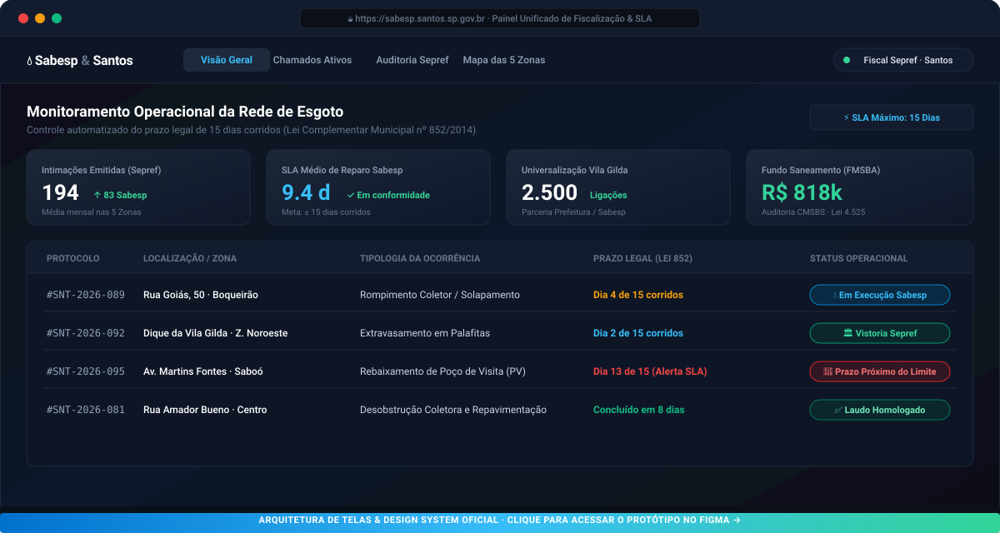
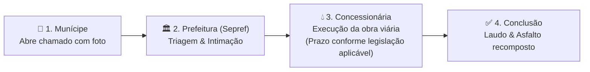

<h1 align="center">💧 Sabesp &amp; Prefeitura de Santos</h1>

  <b>Proposta de plataforma digital para registro, acompanhamento e fiscalização de ocorrências relacionadas à rede de esgoto e à recomposição de vias públicas em Santos (SP).</b>

  
  
  
  
  

  

> ℹ️ **Aviso de Natureza Acadêmica:**  
> Este é um projeto acadêmico independente desenvolvido para o Trabalho de Conclusão de Curso (TCC). A menção à Sabesp e à Prefeitura de Santos contextualiza o problema estudado e os atores considerados na proposta; não implica parceria, vínculo institucional, aprovação ou integração oficial com esses órgãos. Enquanto as funcionalidades não forem implementadas e validadas, a plataforma não deve ser considerada um canal oficial de atendimento.

---

## 📌 Sobre o Projeto

O projeto propõe uma plataforma digital para registrar, acompanhar e fiscalizar ocorrências relacionadas a vazamentos na rede de esgoto, abatimentos de pavimento e desobstruções no município de **Santos (SP)**.

A proposta busca organizar o fluxo entre **munícipes**, **fiscalização municipal (`Sepref` / `Semam`)** e **operação da concessionária (`Sabesp`)**, reunindo informações do chamado, evidências fotográficas, encaminhamentos, prazos legais e histórico de ações em um processo transparente e auditável.

O trabalho reúne pesquisa de contexto, diagnóstico territorial, levantamento de requisitos, modelagem de processos, documentação técnica e prototipagem de interface. A implementação do banco de dados e do backend está prevista para as próximas etapas do roadmap.

### 🎯 Objetivos da Proposta

* **Facilitar o registro de ocorrências** pelos munícipes por meio de interface mobile simples, com upload de fotos e geolocalização.
* **Melhorar a visibilidade do andamento dos chamados**, substituindo protocolos lentos por uma linha do tempo visual (*stepper*).
* **Apoiar a triagem e o encaminhamento ágil**, diferenciando com precisão águas pluviais (drenagem municipal) de esgotamento sanitário (concessionária).
* **Centralizar evidências e registros de fiscalização**, municiando os fiscais das Prefeituras Regionais para cobrança formal de prazos.
* **Auditar prazos e histórico de ações**, acompanhando o cumprimento dos prazos e obrigações legais de recomposição do pavimento urbano.

---

## 🧭 Como Explorar este Repositório

* 🎨 **[Explorar o Protótipo no Figma](https://www.figma.com/design/Tb4SDE9A4oEpLaXfN7aAhe/Projeto-%7C-Sabesp?node-id=0-1&t=yQExxpGpTtvoIWHk-1):** Conheça a proposta visual, sitemap, wireframes e fluxos interativos de uso.
* 📚 **[Consultar a Documentação Técnica (Docs Hub)](docs/README.md):** Requisitos (`MoSCoW`), modelo relacional (`Proto SQL`), regras de negócio (`RBAC`) e marco legal de Santos.
* 🗺️ **[Acompanhar o Roadmap](#-roadmap-de-desenvolvimento):** Veja as etapas conceituais concluídas e os próximos passos previstos no projeto.

---

## 📊 O Cenário Real em Números

Santos possui desafios de saneamento e zeladoria urbana que envolvem a manutenção da infraestrutura subterrânea histórica e consolidada do município, a fiscalização de prestadoras de serviço e a coordenação entre diferentes órgãos públicos:

* **Atendimento e Cobertura de Esgotamento:** Segundo o balanço municipal de saneamento referente ao período de 2020–2024 ([Prefeitura de Santos, 2026](https://www.santos.sp.gov.br/?q=node%2F170908)), o município registrou 98,43% de atendimento total de esgoto e 81,91% de tratamento total. Esses indicadores são distintos das metas e dos indicadores de coleta e tratamento descritos no [PMISB (Relatório R4)](https://www.santos.sp.gov.br/static/files_www/conteudo/13%20Anexo%205%20-%20Plano%20Municipal%20Integrado%20de%20Saneamento%20B%C3%A1sico.pdf). Para áreas de vulnerabilidade, destaca-se a iniciativa de regularização das ligações de água e esgoto no [Dique da Vila Gilda](https://www.santos.sp.gov.br/?q=noticia/parceria-garante-regularizacao-da-rede-de-agua-e-esgoto-para-a-vila-gilda-em-santos), com previsão de cerca de 2.500 ligações (2025–2026).
* **Prazo Legal para Recomposição Viária:** A legislação municipal ([Lei Complementar nº 852/2014](https://egov.santos.sp.gov.br/legis/documents/5195)) prevê prazo de 15 dias para a recomposição do pavimento nas situações e condições previstas na norma, contado conforme o marco legal aplicável (não se tratando de um tempo de atendimento operacional garantido pela concessionária).
* **Faixas de Acompanhamento na Ouvidoria:** O [SOM Web / 162](https://egov.santos.sp.gov.br/somweb/) apresenta categorias de ocorrências em tramitação por tempo decorrido, incluindo faixas de até 30 dias, de 31 a 60 dias e acima de 60 dias. Essas faixas contextualizam o acompanhamento das demandas nos canais convencionais, mas não devem ser interpretadas isoladamente como prazos oficiais de resolução. ([Ver diagnóstico](docs/institucional/contexto-e-legislacao.md#-o-descompasso-entre-faixas-de-acompanhamento-da-ouvidoria-e-prazos-da-lei-nº-8522014))
* **+190 Intimações em Balanço Oficial:** Volume registrado em balanço oficial da Prefeitura de Santos ([janeiro/2024](https://www.santos.sp.gov.br/?q=noticia/santos-aplica-197-intimacoes-e-notificacoes-a-prestadoras-de-servico-em-janeiro)), no qual a Secretaria de Prefeituras Regionais (Sepref) contabilizou 197 intimações e notificações a prestadoras de serviço (sendo 83 direcionadas à concessionária de saneamento) por pendências ou danos nas vias públicas atendidas pelas cinco Prefeituras Regionais.
* **Sanção Administrativa Ambiental (2023):** Multa de R$ 818 mil aplicada pela Secretaria Municipal de Meio Ambiente (SEMAM) em março de 2023 após vazamento que solapou a Rua Goiás ([Notícia Oficial PMS](https://www.santos.sp.gov.br/?q=noticia/santos-multa-sabesp-em-r-818-mil-reais-devido-a-contaminacao-de-solo-na-rua-goias) • [G1](https://g1.globo.com/sp/santos-regiao/noticia/2023/03/07/sabesp-e-multada-em-r-818-mil-apos-contaminacao-de-solo-na-rua-goias-em-santos-sp.ghtml)). A legislação municipal posterior ([Lei nº 4.525/2024](https://egov.santos.sp.gov.br/legis/documents/10840)) prevê, entre as fontes de recursos do Fundo Municipal de Saneamento Básico e Ambiental (FMSBA), sob controle social do [CMSBS](https://egov.santos.sp.gov.br/legis/documents/12103), receitas provenientes de multas e juros vinculados aos contratos e convênios especificados em seu artigo 4º, inciso VII. Essa previsão não comprova a liquidação ou o repasse efetivo da multa de R$ 818 mil mencionada no caso.

> ⚠️ **Nota Metodológica:** Os dados acima são referências de contextualização territorial, não indicadores de desempenho da plataforma. Antes de utilizar os números em apresentações ou entregas acadêmicas, recomenda-se confirmar no documento original a data de referência, a definição do indicador e o contexto da informação. A documentação reúne mais detalhes em [Contexto e Legislação](docs/institucional/contexto-e-legislacao.md).

---

## 💎 Públicos e Benefícios Esperados

| Público | Necessidade Considerada | Contribuição Proposta pelo Sistema |
| :--- | :--- | :--- |
| **📱 Munícipe** | Registrar ocorrências com rapidez e acompanhar o andamento sem burocracia. | [Proposta de abertura em 3 passos](docs/design-ux/jornada-e-ux.md#-fluxo-mobile-do-munícipe-3-passos) com fotos e geolocalização, e [linha do tempo visual (stepper)](docs/design-ux/jornada-e-ux.md#-linha-do-tempo-de-acompanhamento-stepper-visual) sem depender de ligações no `162`. |
| **🏛️ Prefeitura (`Sepref` / `Semam`)** | Triar ocorrências, encaminhar demandas ao órgão correto e auditar prazos legais. | Proposta de painel centralizado de triagem nas [cinco regiões administrativas](docs/institucional/contexto-e-legislacao.md#%EF%B8%8F-regionaliza%C3%A7%C3%A3o-administrativa-as-5-zonas-de-santos), despacho de intimações e monitoramento do cumprimento do prazo de `15 dias` da [Lei nº 852/2014](docs/institucional/contexto-e-legislacao.md#-marco-regulat%C3%B3rio-lei-complementar-municipal-n%C2%BA-8522014). |
| **💧 Concessionária (`Sabesp`)** | Receber demandas tecnicamente qualificadas e comprovar a execução do reparo. | Recepção de chamados [pré-validados na triagem](docs/institucional/triagem-inteligente.md), com proposta de registro de laudo de campo e comprovação fotográfica da recomposição viária. |

> ℹ️ *Esses benefícios descrevem o desenho da solução proposta. A disponibilidade efetiva de cada recurso depende da implementação técnica e de eventuais validações institucionais.*

### 🔄 Fluxo Operacional Proposto

> *O fluxo acima é conceitual. A atribuição de responsabilidades, os prazos e os critérios de encaminhamento seguem as normas municipais e as regras de negócio documentadas no projeto.*

---

## ⚙️ Funcionalidades Propostas & Estágio de Desenvolvimento

Para garantir clareza e transparência no ciclo de vida do software, as capacidades da plataforma são categorizadas por estágio real de entrega:

| Funcionalidade | Módulo Responsável | Estágio de Desenvolvimento |
| :--- | :--- | :---: |
| Abertura simplificada de ocorrências com geolocalização e fotos | Munícipe | `Em prototipagem (Figma)` |
| Acompanhamento transparente do chamado via Stepper visual | Munícipe | `Em prototipagem (Figma)` |
| Triagem lógica inteligente (segregação de drenagem pluvial vs. rede de esgoto) | Prefeitura (Sepref) | `Especificada na documentação` |
| Painel administrativo de triagem e despacho por Prefeituras Regionais (5 zonas) | Prefeitura (Sepref) | `Em prototipagem (Figma)` |
| Contagem regressiva e auditoria do prazo de 15 dias da Lei nº 852/2014 | Prefeitura / Sabesp | `Especificada na documentação` |
| Recepção de ordens de serviço, registro de parecer de campo e laudo fotográfico | Sabesp (Operação) | `Especificada na documentação` |
| Trilha de auditoria cronológica com modelo Append-Only para mudanças de status | Sistema / Auditoria | `Modelada conceitualmente (Proto SQL)` |
| API RESTful documentada (Swagger), controle RBAC e banco relacional em nuvem | Core Backend | `Planejada para implementação (Fases 6/7)` |

---

## 🌍 Compromisso com os Objetivos de Desenvolvimento Sustentável (ODS)

Este projeto está alinhado à **[Agenda 2030 da Organização das Nações Unidas (ONU)](https://brasil.un.org/pt-br/sdgs)**, colaborando com metas de saneamento, infraestrutura e governança urbana:

* **[ODS 6 · Água Potável e Saneamento](https://brasil.un.org/pt-br/sdgs/6):** Contribuição para a mitigação de impactos decorrentes de extravasamentos em canais de drenagem e praias de Santos.
* **[ODS 9 · Indústria, Inovação e Infraestrutura](https://brasil.un.org/pt-br/sdgs/9):** Proposta de modernização da gestão urbana por meio de esteira digital e processos rastreáveis.
* **[ODS 11 · Cidades e Comunidades Sustentáveis](https://brasil.un.org/pt-br/sdgs/11):** Apoio à resiliência urbana e suporte a áreas vulneráveis (Dique da Vila Gilda).
* **[ODS 16 · Paz, Justiça e Instituições Eficazes](https://brasil.un.org/pt-br/sdgs/16):** Apoio à transparência ativa, controle social e acompanhamento da destinação legal de receitas vinculadas ao saneamento (`FMSBA`).

---

## 🧭 Central de Documentação (Docs Hub)

A documentação completa do projeto é categorizada em **4 pilares temáticos** (consulte também o **[Portal da Documentação (docs/README.md)](docs/README.md)**):

| Categoria | Módulo | Foco & Conteúdo |
| :---: | :--- | :--- |
| 🏛️ **Institucional** | [**Contexto & Legislação**](docs/institucional/contexto-e-legislacao.md) | Diagnóstico territorial de Santos, caso Rua Goiás, Vila Gilda, `FMSBA` (`Lei 4.525`), `CMSBS`, órgãos `Sepref` / `Semam` e `ODS`. |
| 🏛️ **Institucional** | [**Triagem Inteligente**](docs/institucional/triagem-inteligente.md) | Árvore de decisão lógica: segregação entre rede de esgoto (`Sabesp`) e drenagem pluvial (`Prefeitura / Seserp`). |
| 🏛️ **Institucional** | [**Glossário Terminológico**](docs/institucional/glossario.md) | Dicionário técnico-jurídico e de infraestrutura sanitária (`PV`, `EEE`, `EPC`, `FMSBA`) no padrão `ABNT`. |
| 🎨 **Design & UX** | [**Personas & Cenários**](docs/design-ux/personas-e-cenarios.md) | `Design Thinking`: perfis de Munícipe (`Dona Helena`), Fiscal (`Sepref`), Operação (`Sabesp`) e Meio Ambiente (`Semam`). |
| 🎨 **Design & UX** | [**Jornada & Arquitetura**](docs/design-ux/jornada-e-ux.md) | Arquitetura da informação, sitemap completo, wireframes textuais e linha do tempo de acompanhamento (`Stepper`). |
| 🎨 **Design & UX** | [**Design System & UI**](docs/design-ux/design-system.md) | Tipografia `Montserrat`, catálogo de brasões vetoriais `.svg` da Prefeitura de Santos e protótipo no `Figma`. |
| ⚙️ **Engenharia** | [**Requisitos do Sistema**](docs/engenharia/requisitos-do-sistema.md) | Matriz `MoSCoW` (`RF01–RF13` e `RNF01–RNF07`), regras de negócio e tipologias oficiais do `PMISB` (Relatório R4). |
| ⚙️ **Engenharia** | [**Arquitetura & Banco**](docs/engenharia/arquitetura-e-banco.md) | Ciclo de vida do chamado, matriz de status, modelo ER (`Proto SQL`), `Soft Delete` e auditoria `Append-Only`. |
| ⚙️ **Engenharia** | [**Regras de Negócio & API**](docs/engenharia/regras-e-api.md) | Controle de acesso por papéis (`RBAC`), validações de domínio e catálogo de rotas `RESTful` documentadas com `Swagger UI`. |
| ⚙️ **Engenharia** | [**Gestão de Riscos**](docs/engenharia/matriz-de-riscos.md) | Matriz de riscos `ISO 31000` / `PMBOK`: mitigação de trotes, conformidade `LGPD`, interferências de concessionárias e maré. |
| 🎓 **Acadêmico** | [**Metodologia TCC**](docs/academico/metodologia-tcc.md) | Tema, problema de pesquisa, objetivos, justificativa tríplice e mapeamento metodológico padrão `ABNT NBR 14724`. |

---

## 🗺️ Roadmap de Desenvolvimento

- [x] **Fase 1 · Concepção e Marco Legal:** Diagnóstico municipal, [Lei 852/2014](https://egov.santos.sp.gov.br/legis/documents/5195), [FMSBA](https://egov.santos.sp.gov.br/legis/documents/10840), [PMISB R4](https://www.santos.sp.gov.br/static/files_www/conteudo/13%20Anexo%205%20-%20Plano%20Municipal%20Integrado%20de%20Saneamento%20B%C3%A1sico.pdf) e esteira de valor. ([Ver Documento](docs/institucional/contexto-e-legislacao.md))
- [x] **Fase 2 · Modelagem e Arquitetura:** [Proto SQL & Logs](docs/engenharia/arquitetura-e-banco.md), `Soft Delete` e [Matriz de Requisitos RF01–RF13](docs/engenharia/requisitos-do-sistema.md).
- [x] **Fase 3 · Identidade Visual:** Padronização dos vetores oficiais `.svg` da Prefeitura de Santos e tipografia `Montserrat`. ([Ver Design System](docs/design-ux/design-system.md))
- [x] **Fase 4 · Design Thinking & UX:** [Personas](docs/design-ux/personas-e-cenarios.md), [Triagem Inteligente](docs/institucional/triagem-inteligente.md), [Jornada do Usuário](docs/design-ux/jornada-e-ux.md) e [Matriz de Riscos](docs/engenharia/matriz-de-riscos.md).
- [ ] **Fase 5 · Prototipagem UI/UX (Em Andamento):** Telas interativas no [Figma](https://www.figma.com/design/Tb4SDE9A4oEpLaXfN7aAhe/Projeto-%7C-Sabesp?node-id=0-1&t=yQExxpGpTtvoIWHk-1) (Munícipe, Fiscalização Municipal e Operação Sabesp).
- [ ] **Fase 6 · Banco em Nuvem (Planejada):** Implementação física do schema relacional no `PostgreSQL` ([Supabase](https://supabase.com/)).
- [ ] **Fase 7 · Backend Spring Boot (Planejada):** Desenvolvimento da API `RESTful` em [Spring Boot 3](https://spring.io/projects/spring-boot) com autenticação, validações e `RBAC`.

---

## ⚖️ Limitações de Escopo & Próximos Cuidados

Por se tratar de uma proposta acadêmica em evolução por etapas, o projeto delimita os seguintes cuidados técnicos e normativos:

* **Validação Normativa Contínua:** As regras de negócio e os prazos operacionais devem ser constantemente confrontados com eventuais atualizações de decretos municipais e da agência reguladora estadual (ARSESP).
* **Delimitação de Procedimentos:** Definição clara das responsabilidades e limites de atuação entre as Secretarias Municipais (`Sepref`, `Seserp`, `Semam`) e a concessionária para cada tipologia de ocorrência.
* **Privacidade, Minimização de Dados e LGPD:** O projeto prevê a aplicação do princípio da minimização de dados, conforme a [Lei Federal nº 13.709/2018 (LGPD)](https://www.planalto.gov.br/ccivil_03/_ato2015-2018/2018/lei/l13709.htm). As consultas públicas deverão restringir a exposição de informações pessoais e de localização exata (adotando agregação por logradouro/bairro), e a definição dos controles de acesso, da retenção e das medidas de proteção será aprofundada durante a implementação, considerando a necessidade de Relatório de Impacto à Proteção de Dados (RIPD).
* **Ausência de Integração Legada:** O sistema não possui integração em tempo real com os sistemas internos da Sabesp ou da Prefeitura; opera como arquitetura de referência aberta (RESTful/OpenAPI) simulando a interoperabilidade. Não deve ser considerado canal oficial de atendimento.

---

## 👥 Autoria

Projeto concebido e desenvolvido para o Trabalho de Conclusão de Curso (TCC) por:

<table align="center">
  <tr>
    <td align="center" width="160px">
      <a href="https://github.com/CarvalhoNathan">
         
        <b>Nathan Carvalho</b>
      </a>
    </td>
    <td align="center" width="160px">
      <a href="https://github.com/DreyCelestino">
         
        <b>Andrey Celestino</b>
      </a>
    </td>
  </tr>
</table>

---

## 📄 Licença

Este projeto é desenvolvido para fins acadêmicos e educacionais sob os termos da **[Licença MIT](LICENSE)**. Padrões de branching e desenvolvimento no **[Guia de Contribuição (CONTRIBUTING.md)](CONTRIBUTING.md)**.  
&copy; 2026 Nathan Carvalho & Andrey Celestino.

---

  <a href="#topo">↑ Voltar ao topo</a>

