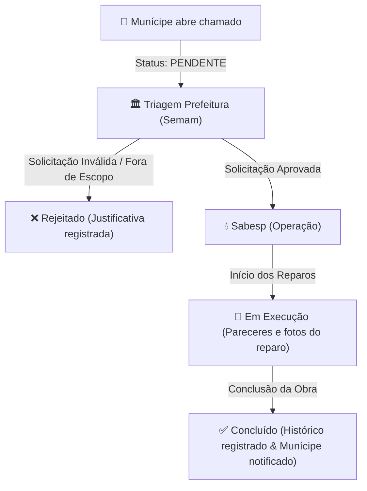
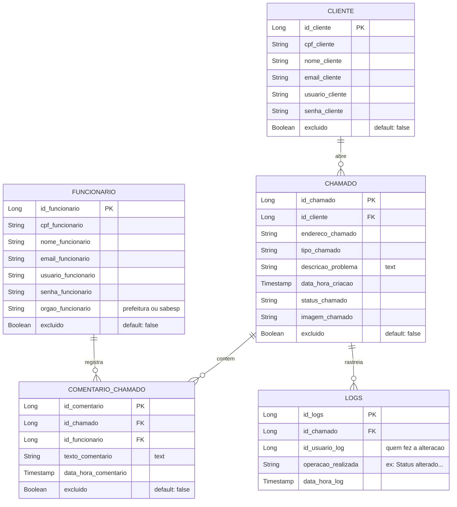

# 💧 Sabesp & Semam - Gestão e Auditoria de Obras na Rede de Esgoto (Santos)

<p align="center">
  
  
  
  
  
  
</p>

Um sistema web desenvolvido para modernizar e conferir transparência ao fluxo de requisições e obras na rede de esgoto do município de Santos. O projeto integra a população, a Secretaria de Meio Ambiente (Semam) e a Sabesp em uma única plataforma centralizada de auditoria, fiscalização e controle operacional.

---

## 📌 Índice

- [Visão Geral](#-visão-geral)
- [O Problema Real vs. Solução Proposta](#-o-problema-real-vs-solução-proposta)
- [Contexto Institucional, Regionalização e Marco Legal](#-contexto-institucional-regionalização-e-marco-legal)
- [Alinhamento com os ODS da ONU](#-alinhamento-com-os-ods-da-onu)
- [Ciclo de Vida do Chamado](#-ciclo-de-vida-do-chamado)
- [Funcionalidades por Perfil](#-funcionalidades-por-perfil)
- [Regras de Negócio e Controle de Acesso (RBAC)](#-regras-de-negócio-e-controle-de-acesso-rbac)
- [Tecnologias Utilizadas](#-tecnologias-utilizadas)
- [Arquitetura de Software e Banco de Dados](#-arquitetura-de-software-e-banco-de-dados-proto-sql)
- [Endpoints Principais da API](#-endpoints-principais-da-api)
- [Como Executar o Projeto](#-como-executar-o-projeto)
- [Design System e Prototipagem](#-design-system-e-prototipagem)
- [Roadmap de Desenvolvimento](#-roadmap-de-desenvolvimento)
- [Equipe de Desenvolvimento](#-equipe-de-desenvolvimento)

---

## 🔍 Visão Geral

Historicamente, as solicitações sobre vazamentos e problemas na rede de esgoto dependem de canais fragmentados, dificultando o acompanhamento pelo cidadão e a fiscalização do município sobre os prazos da concessionária.

Esta plataforma soluciona esse gargalo criando uma **esteira de atendimento transparente e auditável**:

1. O cidadão registra o chamado com fotos, tipo de ocorrência e localização.
2. A Prefeitura (Semam/Gestão) atua como órgão fiscalizador e regulador, realizando a triagem técnica e regionalizada.
3. A Sabesp recebe as ordens oficiais já auditadas para execução em campo e atualiza o progresso em tempo real com comprovações técnicas.

---

## ⚖️ O Problema Real vs. Solução Proposta

Atualmente no município de Santos, demandas de manutenção urbana (como vazamentos na rede coletora de esgoto, abatimentos asfálticos e tampas danificadas) tramitam por processos manuais e burocráticos:

| Processo Atual (Ouvidoria / Manual) | Nova Esteira Digital (Sistema Web) |
| :--- | :--- |
| **Abertura:** O munícipe precisa ligar para o telefone 162 (Ouvidoria) ou comparecer presencialmente ao Paço Municipal em horário comercial. | **Abertura Digital 24/7:** Munícipe registra o chamado diretamente pela web com endereço, tipo da ocorrência e foto em segundos. |
| **Triagem e Despacho:** Processamento manual distribuído via ofícios e planilhas entre órgãos e prefeituras regionais. | **Painel Integrado da Prefeitura:** Visualização centralizada e filtros por região administrativa para despacho ágil. |
| **Comunicação com a Sabesp:** Notificações e intimações burocráticas formais, gerando atrito e atrasos na comunicação. | **Acesso Operacional Dedicado:** A Sabesp recebe as ordens já auditadas pela prefeitura diretamente em sua fila de trabalho. |
| **Controle de SLA e Prazos:** Dificuldade em mensurar e auditar o cumprimento do prazo legal de 15 dias corridos. | **Auditoria Automatizada:** Registro imutável de datas para acompanhamento do prazo legal da Lei Complementar nº 852/2014. |
| **Retorno ao Cidadão:** O munícipe não tem visibilidade se o local foi vistoriado ou quando a obra foi concluída. | **Transparência Total:** Acompanhamento do status em tempo real com histórico e parecer técnico conclusivo da Sabesp. |

---

## 🏛️ Contexto Institucional, Regionalização e Marco Legal

A cidade de **Santos** possui particularidades geográficas e históricas marcantes, como seus icônicos **canais de drenagem** projetados por Saturnino de Brito e uma orla de grande relevância turística e ambiental. Vazamentos ou anomalias na rede de esgotamento sanitário afetam diretamente a balneabilidade das praias e a saúde pública do município.

### ⚖️ Marco Regulatório: Lei Complementar Municipal nº 852/2014
No âmbito municipal, a relação entre a Prefeitura de Santos e a concessionária Sabesp é respaldada por rigorosa legislação fiscalizatória:
- **Prazo Legal de Atendimento:** A concessionária possui o prazo máximo de **15 dias corridos** para concluir os reparos após a notificação formal.
- **Penalidades Financeiras:** O descumprimento dos prazos ou a realização de obras em desconformidade que acarretem risco à mobilidade urbana e à segurança sujeita a concessionária a multas a partir de **R$ 17.045,05** por ocorrência.
- O sistema atua como **plataforma probatória e de auditoria**, permitindo à gestão pública evidenciar os prazos decorridos e instruir eventuais processos administrativos sancionatórios.

### 🏙️ Regionalização Administrativa (As 5 Zonas de Santos)
A fiscalização urbana do município atua dividida em **5 Prefeituras Regionais**, mapeadas nos filtros da aplicação para distribuição geográfica das demandas:
1. **Zona da Orla / Intermediária:** Maior adensamento populacional e proximidade direta com a faixa de areia e canais de drenagem.
2. **Centro Histórico:** Área com patrimônio histórico tombado e rede subterrânea centenária.
3. **Zona Noroeste:** Bacia urbana densa com demandas frequentes de macrodrenagem e esgotamento.
4. **Morros:** Geografia acidentada que exige cuidados geotécnicos e contenção de vazamentos em encostas.
5. **Área Continental:** Ampla extensão territorial com características rurais e ecossistema de manguezais.

### 🌿 Secretaria Municipal de Meio Ambiente, Desenvolvimento Urbano e Sustentabilidade (SEMAM)
- **Missão e Fiscalização:** Órgão municipal responsável pela proteção do ecossistema urbano e controle ambiental, atuando por meio do **DEPCAM** (Departamento de Políticas e Controle Ambiental) e da **SEFISCAM** (Seção de Fiscalização Ambiental).
- **Proteção dos Canais e da Orla:** Atua preventivamente e repressivamente para impedir que efluentes sanitários alcancem as galerias de drenagem de águas pluviais que desembocam nos canais e nas praias.
- **Poder Regulador e Notificação:** Recebe denúncias da população, valida tecnicamente as irregularidades in loco e formaliza as ordens de reparo cobrando prazos de execução da concessionária.

### 💧 Sabesp (Unidade de Negócio Baixada Santista)
- **Operação e Manutenção do Saneamento:** Concessionária responsável pela coleta, transporte e tratamento de esgoto de Santos. Opera estações elevatórias, a Estação de Pré-Condicionamento (EPC) no José Menino e o Emissário Submarino de Santos.
- **Marco Legal do Saneamento (Lei Federal nº 14.026/2020):** Compromisso com metas contínuas de eficiência operacional, universalização do esgotamento sanitário, combate a perdas e redução no tempo de atendimento emergencial a vazamentos.
- **Transparência e Comprovação Técnica:** Na plataforma, a Sabesp registra pareceres técnicos formais, histórico de manutenções e registros fotográficos da obra concluída, garantindo conformidade aos órgãos de controle.

---

## 🌍 Alinhamento com os ODS da ONU

O projeto contribui diretamente para a **Agenda 2030** da Organização das Nações Unidas (ONU), integrando metas essenciais de sustentabilidade urbana:

- **ODS 6 — Água Potável e Saneamento:** Assegurar a disponibilidade e gestão sustentável da água e saneamento para todos, combatendo a contaminação de corpos hídricos e canais urbanos.
- **ODS 9 — Indústria, Inovação e Infraestrutura:** Modernização digital da infraestrutura pública com automação de serviços essenciais de auditoria e manutenção da malha viária e sanitária.
- **ODS 11 — Cidades e Comunidades Sustentáveis:** Fortalecimento da resiliência urbana e da capacidade de resposta rápida do município frente a emergências de infraestrutura urbana.

---

## 🔄 Ciclo de Vida do Chamado



### Matriz de Status

| Status        | Descrição                                                                        | Responsável pela Ação |
| :------------ | :------------------------------------------------------------------------------- | :-------------------- |
| `PENDENTE`    | Chamado recém-criado pelo munícipe aguardando análise prévia.                    | Munícipe              |
| `APROVADO`    | Validado tecnicamente pela Semam e liberado como ordem de serviço para a Sabesp. | Prefeitura (Gestão)   |
| `REJEITADO`   | Recusado pela prefeitura com registro formal de justificativa técnica.           | Prefeitura (Gestão)   |
| `EM_EXECUCAO` | Equipe de campo da Sabesp atuando na resolução do problema.                      | Sabesp (Operação)     |
| `CONCLUIDO`   | Obra finalizada com parecer técnico e histórico de intervenções registrado.      | Sabesp (Operação)     |

---

## 👥 Funcionalidades por Perfil

### 📱 Munícipe (Pessoa Comum)
- Cadastro e login na plataforma (`usuario_cliente` / `senha_cliente`).
- Abertura de chamados informando:
  - Endereço da ocorrência;
  - Tipo do problema (ex: vazamento na via, refluxo, rompimento de coletor);
  - Descrição detalhada;
  - Data e hora;
  - Upload de imagem comprobatória (evidência fotográfica).
- Acompanhamento em tempo real do status da solicitação e histórico de chamados próprios.

### 🏛️ Prefeitura / Semam (Gestão e Fiscalização)
- Acompanhamento centralizado de todas as demandas abertas no município.
- **Filtros avançados** para gestão e triagem (por status, tipo de chamado, endereço/bairro e período).
- Validação técnica da solicitação (aprovação ou rejeição formal).
- Emissão oficial de requisições de serviço e auditoria dos prazos da Sabesp.

### 💧 Sabesp (Operação e Execução Técnica)
- Visualização exclusiva de chamados validados pela prefeitura.
- Alteração do status da solicitação conforme avanço da obra (`EM_EXECUCAO`, `CONCLUIDO`).
- Registro de comentários técnicos e histórico de andamento (`ComentarioChamado`) com evidências da intervenção.

---

## 🔐 Regras de Negócio e Controle de Acesso (RBAC)

Para garantir a privacidade dos munícipes, a integridade da fiscalização pública e a segurança operacional, o sistema adota regras estritas de controle de acesso baseado em perfis (*Role-Based Access Control*):

1. **Isolamento de Dados do Munícipe:**
   - O munícipe autenticado possui permissão de leitura exclusivamente sobre os chamados abertos por ele mesmo (`id_cliente = usuario_autenticado`).
   - Não possui visibilidade sobre chamados ou dados pessoais de outros munícipes.

2. **Poder Fiscalizador da Prefeitura (`orgao_funcionario = 'prefeitura'`):**
   - Acesso irrestrito a todos os chamados registrados no município.
   - Permissão exclusiva para aprovação (despacho oficial para a Sabesp) ou rejeição de chamados com justificativa técnica.
   - Acesso aos relatórios gerenciais e filtros por zonas administrativas de Santos.

3. **Operação Restrita da Sabesp (`orgao_funcionario = 'sabesp'`):**
   - Visualização restrita apenas a chamados com status `APROVADO`. Chamados rejeitados ou ainda pendentes de triagem não são visíveis para a concessionária.
   - Permissão para alterar o status para `EM_EXECUCAO` e `CONCLUIDO`.
   - Permissão para registrar laudos e pareceres em `ComentarioChamado`.

4. **Validações de Domínio:**
   - Validação algorítmica de CPF para munícipes e funcionários.
   - Classificação padronizada de ocorrências: *Vazamento na Via Pública*, *Refluxo de Esgoto*, *Rompimento de Coletor*, *Tampa de Poço de Visita/Bueiro Danificada*.
   - Upload de imagens limitado a arquivos de imagem válidos (PNG, JPG, JPEG) com limite seguro de tamanho.

---

## 🛠️ Tecnologias Utilizadas

- **Linguagem Principal:** Java (JDK 17+)
- **Framework:** Spring Boot
  - Spring Data JPA (Persistência)
  - Spring Web (RESTful API)
  - Spring Validation (Validações de Regra de Negócio)
- **Mapeamento Objeto-Relacional (ORM):** Hibernate
- **Banco de Dados:** PostgreSQL hospedado via Supabase
- **Prototipagem & UI/UX:** Figma
- **Controle de Versão:** Git & GitHub

---

## 🗄️ Arquitetura e Banco de Dados (Proto SQL)

O modelo de dados foi estruturado para atender aos requisitos de auditoria, rastreabilidade e integridade histórica do setor público:

1. **Soft Delete (`excluido: Boolean, default false`):** Aplicado às entidades cadastrais (`Cliente`, `Funcionario`, `Chamado` e `ComentarioChamado`), garantindo que nenhuma informação seja perdida fisicamente.
2. **Trilha de Auditoria (`Logs`):** Estrutura *append-only* (somente inserção) para registro do histórico de operações realizadas no sistema.



### 🏗️ Estrutura de Pacotes do Backend (Spring Boot)

O projeto adota a arquitetura em camadas padrão de aplicações corporativas Spring Boot:

```text
src/main/java/com/santos/sabesp/
├── config/             # Configurações globais (CORS, Segurança, Swagger/OpenAPI)
├── controller/         # Camada de entrada REST (@RestController)
├── dto/                # Data Transfer Objects (Requests e Responses para desacoplamento de entidades)
├── entity/             # Modelos relacionais JPA com anotações de persistência (@Entity)
├── repository/         # Interfaces de persistência e consultas derivadas (Spring Data JPA)
├── service/            # Regras de negócio, validações e controle de transações (@Service)
└── exception/          # Tratamento global de erros e respostas padronizadas (@ControllerAdvice)
```

---

## 🔌 Endpoints Principais da API

A documentação interativa com Swagger UI pode ser acessada em:

```
http://localhost:8080/swagger-ui.html
```

| Método  | Rota                             | Descrição                                              | Acesso                 |
| :------ | :------------------------------- | :----------------------------------------------------- | :--------------------- |
| `POST`  | `/api/chamados`                  | Cadastro de novo chamado com upload de evidência       | Munícipe               |
| `GET`   | `/api/chamados`                  | Listagem paginada e filtrada de chamados               | Autenticado            |
| `GET`   | `/api/chamados/{id}`             | Detalhes completos do chamado e histórico de pareceres | Autenticado            |
| `PATCH` | `/api/chamados/{id}/status`      | Alteração do status do chamado (Triagem ou Obra)       | Prefeitura / Sabesp    |
| `POST`  | `/api/chamados/{id}/comentarios` | Inserção de parecer ou comentário técnico              | Prefeitura / Sabesp    |
| `GET`   | `/api/logs`                      | Consulta da trilha de auditoria                        | Prefeitura (Auditoria) |

---

## 🚀 Como Executar o Projeto

### Pré-requisitos

- **Java JDK 17** ou superior instalado
- **Apache Maven 3.8+** instalado (ou utilizar o wrapper `./mvnw`)
- Instância ativa do **PostgreSQL** (ou projeto no **Supabase**)

### Passo a Passo

1. **Clonar o Repositório:**

   ```bash
   git clone https://github.com/CarvalhoNathan/sabesp.git
   cd sabesp
   ```

2. **Configuração do Banco de Dados:**
   No diretório `src/main/resources/application.properties`, configure a string de conexão do Supabase/PostgreSQL:

   ```properties
   spring.datasource.url=jdbc:postgresql://<HOST_SUPABASE>:5432/<DATABASE>
   spring.datasource.username=postgres
   spring.datasource.password=<SUA_SENHA_DO_SUPABASE>

   spring.jpa.hibernate.ddl-auto=update
   spring.jpa.show-sql=true
   spring.jpa.properties.hibernate.dialect=org.hibernate.dialect.PostgreSQLDialect
   ```

3. **Compilar e Executar:**
   ```bash
   mvn spring-boot:run
   ```
   A aplicação estará disponível em `http://localhost:8080`.

---

## 🎨 Design System e Prototipagem

O design de interface e a experiência do usuário (UI/UX) foram projetados no Figma com fluxos e telas específicas para **Munícipe**, **Prefeitura** e **Sabesp**.

* **Tipografia Oficial:** Utilização da família de fontes **`Montserrat`**, conforme o manual de identidade visual da Prefeitura de Santos.
* **Assets e Vetores Oficiais:** Disponíveis e organizados na pasta [`assets/logo-prefeitura/`](assets/logo-prefeitura/) em formato `.svg` para fundos claros e escuros.
* **Identidade Visual Digital:** A paleta cromática está sendo modernizada no protótipo para um design contemporâneo de produto digital (GovTech/SaaS), integrando a identidade institucional da Sabesp com tons sustentáveis atuais que serão definidos e documentados na evolução do projeto.

> 🔗 **Acesse o Protótipo no Figma:** _([Projeto Sabesp](https://www.figma.com/design/Tb4SDE9A4oEpLaXfN7aAhe/Projeto-%7C-Sabesp?node-id=0-1&t=yQExxpGpTtvoIWHk-1))_

---

## 🗺️ Roadmap de Desenvolvimento

Acompanhamento do status de entrega dos módulos do projeto:

- [x] Levantamento de requisitos e fundamentação legal (Lei Complementar nº 852/2014)
- [x] Mapeamento das 5 Zonas Administrativas de Santos e esteira de atendimento
- [x] Modelagem do Banco de Dados (Proto SQL & Imutabilidade de Auditoria)
- [x] Coleta e padronização dos assets vetoriais oficiais (`assets/logo-prefeitura`)
- [ ] Prototipagem completa das interfaces no Figma (Munícipe, Gestão Semam e Operação Sabesp)
- [ ] Criação do esquema e tabelas relacionais no PostgreSQL (Supabase)
- [ ] Setup do projeto Spring Boot com dependências Maven
- [ ] Implementação das entidades JPA, DTOs e Repositories
- [ ] Desenvolvimento dos Services e Controllers REST com validações de negócio
- [ ] Implementação de autenticação e autorização por perfil (RBAC)
- [ ] Integração com serviço de armazenamento de arquivos em nuvem para fotos de evidência
- [ ] Cobertura de testes unitários e de integração

---

## 👨‍💻 Equipe de Desenvolvimento

Projeto acadêmico desenvolvido por:

- **Nathan Carvalho** - [GitHub](https://github.com/CarvalhoNathan)
- **Andrey Celestino** - [GitHub](https://github.com/DreyCelestino)

---

## 📄 Licença

Este projeto é desenvolvido para fins acadêmicos e educacionais. Consulte o arquivo de licença para maiores detalhes.
