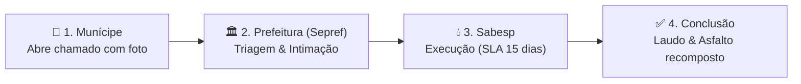

<a id="topo"></a>
<h1 align="center">💧 Sabesp &amp; Prefeitura de Santos</h1>
<p align="center">
  <b>Auditoria pública e esteira digital para fiscalização da rede de esgoto municipal</b>
</p>

<p align="center">
  <a href="https://dev.java/" target="_blank"></a>
  <a href="https://spring.io/projects/spring-boot" target="_blank"></a>
  <a href="https://www.postgresql.org/" target="_blank"></a>
  <a href="https://supabase.com/" target="_blank"></a>
  <a href="https://www.figma.com/design/Tb4SDE9A4oEpLaXfN7aAhe/Projeto-%7C-Sabesp?node-id=0-1&t=yQExxpGpTtvoIWHk-1" target="_blank"></a>
  <a href="LICENSE"></a>
</p>

<p align="center">
  <a href="https://www.figma.com/design/Tb4SDE9A4oEpLaXfN7aAhe/Projeto-%7C-Sabesp?node-id=0-1&t=yQExxpGpTtvoIWHk-1" target="_blank">
    
  </a>
</p>

<p align="center">
  <a href="https://www.figma.com/design/Tb4SDE9A4oEpLaXfN7aAhe/Projeto-%7C-Sabesp?node-id=0-1&t=yQExxpGpTtvoIWHk-1" target="_blank">
    
  </a>
  &nbsp;&nbsp;
  <a href="docs/README.md">
    
  </a>
</p>

---

## 📊 O Cenário Real em Números

* **99% de Cobertura Urbana:** Conforme o [PMISB (Relatório R4)](https://www.santos.sp.gov.br/static/files_www/conteudo/13%20Anexo%205%20-%20Plano%20Municipal%20Integrado%20de%20Saneamento%20B%C3%A1sico.pdf), o desafio de Santos não é a falta de rede, mas a manutenção de uma malha centenária e o fechamento do déficit de 1% em palafitas (como o projeto de 2.500 ligações no [Dique da Vila Gilda](https://www.santos.sp.gov.br/?q=noticia/parceria-garante-regularizacao-da-rede-de-agua-e-esgoto-para-a-vila-gilda-em-santos)).
* **15 Dias Corridos:** Prazo legal máximo improrrogável estabelecido pela [Lei Complementar nº 852/2014](https://egov.santos.sp.gov.br/legis/documents/5195) para a Sabesp concluir reparos na via pública após notificação.
* **30 a 60 Dias na Ouvidoria:** O descompasso da Ouvidoria tradicional ([SOM Web / 162](https://egov.santos.sp.gov.br/somweb/)), que considera "normal" prazos de até 30 dias enquanto a lei municipal exige solução em 15. ([Ver diagnóstico](docs/institucional/contexto-e-legislacao.md#-a-disparidade-crítica-de-slas-ouvidoria-som-web-vs-lei-nº-8522014))
* **+190 Intimações / Mês:** Volume real de intimações emitidas pelos fiscais das Prefeituras Regionais ([Sepref](https://www.santos.sp.gov.br/?q=noticia/santos-aplica-197-intimacoes-e-notificacoes-a-prestadoras-de-servico-em-janeiro)) para cobrar concessionárias por reparos nas vias.
* **R$ 818 Mil em Multa:** Sanção histórica aplicada pela SEMAM contra a Sabesp após vazamento que solapou a Rua Goiás ([Notícia Oficial PMS](https://www.santos.sp.gov.br/?q=noticia/santos-multa-sabesp-em-r-818-mil-reais-devido-a-contaminacao-de-solo-na-rua-goias) • [G1](https://g1.globo.com/sp/santos-regiao/noticia/2023/03/07/sabesp-e-multada-em-r-818-mil-apos-contaminacao-de-solo-na-rua-goias-em-santos-sp.ghtml)), valor revertido ao [Fundo Municipal de Saneamento (FMSBA)](https://egov.santos.sp.gov.br/legis/documents/10840) fiscalizado pelo [CMSBS](https://egov.santos.sp.gov.br/legis/documents/12103).

---

## 💎 Os Três Pilares da Solução

| 📱 Para o Munícipe | 🏛️ Para a Prefeitura ([Sepref / Semam](docs/institucional/contexto-e-legislacao.md#-atuação-e-papel-dos-órgãos-públicos-municipais)) | 💧 Para a Sabesp |
| :--- | :--- | :--- |
| **Voz Ativa & Agilidade** | **Controle & Fiscalização** | **Operação & Rastreabilidade** |
| [Abertura em 3 passos](docs/design-ux/jornada-e-ux.md#-fluxo-mobile-do-munícipe-3-passos) com fotos e geolocalização. [Linha do tempo visual](docs/design-ux/jornada-e-ux.md#-linha-do-tempo-de-acompanhamento-stepper-visual) sem depender do `162` ou prazos lentos de `60 dias`. | Painel centralizado com triagem nas [5 Zonas](docs/institucional/contexto-e-legislacao.md#%EF%B8%8F-regionaliza%C3%A7%C3%A3o-administrativa-as-5-zonas-de-santos) de Santos, despacho automático de intimações e auditoria do prazo de `15 dias` da [Lei nº 852/2014](docs/institucional/contexto-e-legislacao.md#-marco-regulat%C3%B3rio-lei-complementar-municipal-n%C2%BA-8522014). | Recepção de ordens [pré-validadas na triagem](docs/institucional/triagem-inteligente.md), laudo técnico com parecer de campo e comprovação fotográfica do reparo viário. |

### 🔄 Fluxo Operacional Integrado



---

## 🌍 Compromisso com os Objetivos de Desenvolvimento Sustentável (ODS)

Este projeto está alinhado à **[Agenda 2030 da Organização das Nações Unidas (ONU)](https://brasil.un.org/pt-br/sdgs)**, contribuindo diretamente para 4 metas globais:

<p align="center">
  <a href="https://brasil.un.org/pt-br/sdgs/6" target="_blank">
    
  </a>
  &nbsp;&nbsp;&nbsp;&nbsp;
  <a href="https://brasil.un.org/pt-br/sdgs/9" target="_blank">
    
  </a>
  &nbsp;&nbsp;&nbsp;&nbsp;
  <a href="https://brasil.un.org/pt-br/sdgs/11" target="_blank">
    
  </a>
  &nbsp;&nbsp;&nbsp;&nbsp;
  <a href="https://brasil.un.org/pt-br/sdgs/16" target="_blank">
    
  </a>
</p>

* **[ODS 6 · Água Potável e Saneamento](https://brasil.un.org/pt-br/sdgs/6):** Assegurar a disponibilidade e manejo sustentável da água e esgotamento para todos, mitigando a contaminação de canais urbanos e praias de Santos.
* **[ODS 9 · Indústria, Inovação e Infraestrutura](https://brasil.un.org/pt-br/sdgs/9):** Modernizar a infraestrutura de zeladoria com tecnologia digital e esteira auditada de ordens de serviço.
* **[ODS 11 · Cidades e Comunidades Sustentáveis](https://brasil.un.org/pt-br/sdgs/11):** Fortalecer a resiliência urbana e a universalização em áreas vulneráveis de palafitas (Dique da Vila Gilda).
* **[ODS 16 · Paz, Justiça e Instituições Eficazes](https://brasil.un.org/pt-br/sdgs/16):** Assegurar transparência pública, responsabilização regulatória da concessionária e destinação das multas ao fundo municipal (FMSBA).

---

## 🧭 Central de Documentação (Docs Hub)

A documentação é categorizada em **4 pilares temáticos** (consulte também o **[Portal da Documentação (docs/README.md)](docs/README.md)**):

| Categoria | Módulo | Foco & Conteúdo | Link |
| :---: | :--- | :--- | :---: |
| 🏛️ **Institucional** | [**Contexto & Legislação**](docs/institucional/contexto-e-legislacao.md) | Diagnóstico real de Santos, caso Rua Goiás, Vila Gilda, FMSBA (Lei 4.525), CMSBS, Sepref/Semam e ODS. | [Explorar](docs/institucional/contexto-e-legislacao.md) |
| 🏛️ **Institucional** | [**Triagem Inteligente**](docs/institucional/triagem-inteligente.md) | Árvore de decisão lógica: diferenciação entre esgoto (Sabesp) e águas pluviais/chuva (Prefeitura/Seserp). | [Explorar](docs/institucional/triagem-inteligente.md) |
| 🏛️ **Institucional** | [**Glossário Terminológico**](docs/institucional/glossario.md) | Dicionário técnico e jurídico de saneamento santista (PV, EEE, EPC, FMSBA, CMSBS) padrão ABNT. | [Explorar](docs/institucional/glossario.md) |
| 🎨 **Design & UX** | [**Personas & Cenários**](docs/design-ux/personas-e-cenarios.md) | Design Thinking: perfis de Dona Helena (Munícipe), Carlos (Fiscal Sepref), Roberto (Sabesp) e Dra. Renata (Semam). | [Explorar](docs/design-ux/personas-e-cenarios.md) |
| 🎨 **Design & UX** | [**Jornada & Arquitetura**](docs/design-ux/jornada-e-ux.md) | Arquitetura de telas, sitemap completo, wireframe textual e linha do tempo de acompanhamento (Stepper). | [Explorar](docs/design-ux/jornada-e-ux.md) |
| 🎨 **Design & UX** | [**Design System & UI**](docs/design-ux/design-system.md) | Tipografia Montserrat, catálogo de logos vetoriais SVG da Prefeitura de Santos e acesso ao protótipo no Figma. | [Explorar](docs/design-ux/design-system.md) |
| ⚙️ **Engenharia** | [**Requisitos do Sistema**](docs/engenharia/requisitos-do-sistema.md) | Matriz MoSCoW (RF01 a RF13, RNF01 a RNF07), regras de negócio e tipologias oficiais do PMISB (Relatório R4). | [Explorar](docs/engenharia/requisitos-do-sistema.md) |
| ⚙️ **Engenharia** | [**Arquitetura & Banco**](docs/engenharia/arquitetura-e-banco.md) | Ciclo de vida do chamado, matriz de status, modelo ER (Proto SQL), Soft Delete e Logs imutáveis (*Append-Only*). | [Explorar](docs/engenharia/arquitetura-e-banco.md) |
| ⚙️ **Engenharia** | [**Regras de Negócio & API**](docs/engenharia/regras-e-api.md) | Controle de acesso por papéis (RBAC), validações de domínio e catálogo de rotas RESTful com Swagger UI. | [Explorar](docs/engenharia/regras-e-api.md) |
| ⚙️ **Engenharia** | [**Gestão de Riscos**](docs/engenharia/matriz-de-riscos.md) | Matriz de riscos ISO 31000 / PMBOK: trotes, LGPD, conflitos entre concessionárias e condições de maré. | [Explorar](docs/engenharia/matriz-de-riscos.md) |
| 🎓 **Acadêmico** | [**Metodologia TCC**](docs/academico/metodologia-tcc.md) | Tema, problema de pesquisa, objetivos, justificativa tríplice, metodologia científica e mapeamento para monografia ABNT. | [Explorar](docs/academico/metodologia-tcc.md) |

---

## 🛠️ Stack Tecnológica

* **Core Backend:** [Java 17](https://dev.java/) • [Spring Boot 3](https://spring.io/projects/spring-boot) (Data JPA, Security, Web, Validation) • [Hibernate](https://hibernate.org/) • [Lombok](https://projectlombok.org/)
* **Banco de Dados & Nuvem:** [PostgreSQL](https://www.postgresql.org/) • [Supabase](https://supabase.com/)
* **Design & Experiência:** [Figma](https://www.figma.com/design/Tb4SDE9A4oEpLaXfN7aAhe/Projeto-%7C-Sabesp?node-id=0-1&t=yQExxpGpTtvoIWHk-1) • [Identidade Visual Oficial da Prefeitura de Santos](https://www.santos.sp.gov.br/?q=hotsite/manual-de-identidade)
* **Padronização:** RESTful API • [OpenAPI 3 (Swagger UI)](https://swagger.io/specification/) • Git & GitHub

---

## ⚡ Início Rápido (Quickstart)

> ℹ️ **Fase Atual do Projeto (Concepção & Prototipagem):**  
> O projeto encontra-se atualmente na fase de modelagem de requisitos e prototipagem interativa no Figma. Os comandos de execução abaixo referem-se à inicialização do ambiente que será ativada nas **fases 6 e 7** do roadmap.

### 📋 Pré-requisitos de Ambiente (Fases Futuras)
* **Java Development Kit (JDK):** Versão 17 ou superior instalada
* **Apache Maven:** Versão 3.8+ instalada
* **PostgreSQL / Supabase:** Instância relacional ativa
* **Git:** Para versionamento e controle de branches

```bash
# 1. Clone o repositório
git clone https://github.com/CarvalhoNathan/sabesp.git
cd sabesp

# 2. Configure as variáveis de conexão com o Supabase em src/main/resources/application.properties
# spring.datasource.url=jdbc:postgresql://<HOST_SUPABASE>:5432/<DATABASE>
# spring.datasource.username=postgres
# spring.datasource.password=<SUA_SENHA>

# 3. Execute a aplicação (Previsto para Fase 7)
mvn spring-boot:run
```

> Quando ativo, acesse a aplicação em `http://localhost:8080` e a documentação interativa em `http://localhost:8080/swagger-ui.html`.  
> 🤝 Para padrões de branching, commits semânticos e boas práticas de código, consulte o **[Guia de Contribuição (CONTRIBUTING.md)](CONTRIBUTING.md)**.

---

## 🗺️ Roadmap de Entrega

- [x] **Fase 1 · Concepção e Marco Legal:** Diagnóstico municipal, [Lei 852/2014](https://egov.santos.sp.gov.br/legis/documents/5195), [FMSBA](https://egov.santos.sp.gov.br/legis/documents/10840), [PMISB R4](https://www.santos.sp.gov.br/static/files_www/conteudo/13%20Anexo%205%20-%20Plano%20Municipal%20Integrado%20de%20Saneamento%20B%C3%A1sico.pdf) e esteira de valor. ([Ver Documento](docs/institucional/contexto-e-legislacao.md))
- [x] **Fase 2 · Modelagem e Arquitetura:** [Proto SQL & Logs](docs/engenharia/arquitetura-e-banco.md), Soft Delete e [Matriz de Requisitos RF01–RF13](docs/engenharia/requisitos-do-sistema.md).
- [x] **Fase 3 · Identidade Visual:** Padronização dos vetores oficiais `.svg` da Prefeitura de Santos e tipografia Montserrat. ([Ver Design System](docs/design-ux/design-system.md))
- [x] **Fase 4 · Design Thinking & UX:** [Personas](docs/design-ux/personas-e-cenarios.md), [Triagem Inteligente](docs/institucional/triagem-inteligente.md), [Jornada do Usuário](docs/design-ux/jornada-e-ux.md) e [Matriz de Riscos](docs/engenharia/matriz-de-riscos.md).
- [ ] **Fase 5 · Prototipagem UI/UX:** Telas interativas no [Figma](https://www.figma.com/design/Tb4SDE9A4oEpLaXfN7aAhe/Projeto-%7C-Sabesp?node-id=0-1&t=yQExxpGpTtvoIWHk-1) (Munícipe, Fiscalização Municipal e Operação Sabesp).
- [ ] **Fase 6 · Banco em Nuvem:** Implementação do schema relacional no PostgreSQL ([Supabase](https://supabase.com/)).
- [ ] **Fase 7 · Backend Spring Boot:** Desenvolvimento da API RESTful em [Spring Boot 3](https://spring.io/projects/spring-boot) com autenticação, validações e RBAC.

---

## 👥 Autoria

Projeto concebido e desenvolvido para o Trabalho de Conclusão de Curso (TCC) por:

<table align="center">
  <tr>
    <td align="center" width="160px">
      <a href="https://github.com/CarvalhoNathan">
        <br />
        <sub><b>Nathan Carvalho</b></sub>
      </a><br />
    </td>
    <td align="center" width="160px">
      <a href="https://github.com/DreyCelestino">
        <br />
        <sub><b>Andrey Celestino</b></sub>
      </a><br />
    </td>
  </tr>
</table>

---

## 📄 Licença

Este projeto é desenvolvido para fins acadêmicos e educacionais sob os termos da **[Licença MIT](LICENSE)**. Consulte o arquivo para maiores detalhes.  
&copy; 2026 Nathan Carvalho & Andrey Celestino.

---

<p align="center">
  <a href="#topo">↑ Voltar ao topo</a>
</p>
