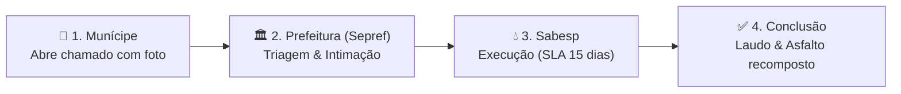

<h1 align="center">💧 Sabesp &amp; Prefeitura de Santos</h1>

  <b>Plataforma digital e esteira de auditoria pública para a fiscalização da rede de esgoto e recomposição viária</b>

  
  
  
  
  

---

## 📌 Sobre o Projeto

Este projeto propõe uma **plataforma digital e esteira de auditoria pública** para registrar, acompanhar e fiscalizar ocorrências relacionadas a vazamentos na rede de esgoto, abatimentos de solo e danos ao pavimento urbano no município de **Santos (SP)**.

A solução busca conectar **munícipes**, **fiscalização municipal (`Sepref` / `Semam`)** e a **operação da concessionária (`Sabesp`)** em um fluxo único, auditável e transparente, visando reduzir o descompasso histórico entre a tramitação lenta dos canais convencionais de ouvidoria e os prazos legais de recomposição das vias públicas.

> ℹ️ **Nota de Natureza Acadêmica:**  
> Este projeto é uma **proposta acadêmica independente** desenvolvida no âmbito do Trabalho de Conclusão de Curso (TCC). Não possui vínculo formal, convênio operacional ou homologação direta com a Prefeitura Municipal de Santos ou com a Sabesp. Todas as regras de negócio e integrações refletem a legislação pública vigente e o planejamento municipal documentado no PMISB.

---

## 🧭 Como Explorar este Repositório

* 🎨 **[Explorar o Protótipo no Figma](https://www.figma.com/design/Tb4SDE9A4oEpLaXfN7aAhe/Projeto-%7C-Sabesp?node-id=0-1&t=yQExxpGpTtvoIWHk-1):** Conheça a proposta visual, sitemap, wireframes e fluxos interativos de uso.
* 📚 **[Consultar a Documentação Técnica (Docs Hub)](docs/README.md):** Requisitos (`MoSCoW`), modelo relacional (`Proto SQL`), regras de negócio (`RBAC`) e marco legal de Santos.
* 🗺️ **[Acompanhar o Roadmap](#-roadmap-de-desenvolvimento):** Veja as entregas conceituais concluídas e os próximos passos de implementação de banco e código.

---

## 🖥️ Demonstração da Interface (Protótipo Figma)

  

---

## 📊 O Cenário Real em Números

* **99% de Cobertura Urbana (2020):** Conforme o [PMISB (Relatório R4)](https://www.santos.sp.gov.br/static/files_www/conteudo/13%20Anexo%205%20-%20Plano%20Municipal%20Integrado%20de%20Saneamento%20B%C3%A1sico.pdf), a área urbana de Santos já dispõe de rede coletora quase universalizada; o desafio central reside na manutenção da malha centenária e no atendimento de áreas de vulnerabilidade, como as 2.500 ligações no [Dique da Vila Gilda](https://www.santos.sp.gov.br/?q=noticia/parceria-garante-regularizacao-da-rede-de-agua-e-esgoto-para-a-vila-gilda-em-santos) (2025–2026).
* **15 Dias Corridos para Recomposição Viária:** Prazo legal máximo improrrogável estabelecido pela [Lei Complementar Municipal nº 852/2014](https://egov.santos.sp.gov.br/legis/documents/5195) para a concessionária concluir o reparo do pavimento e calçadas após notificação de abertura de vala na via pública.
* **30 a 60 Dias na Tramitação da Ouvidoria:** Prazos observados nos canais convencionais de atendimento ([SOM Web / 162](https://egov.santos.sp.gov.br/somweb/)), que toleram até 30 dias de triagem e até 60 dias de tramitação, evidenciando o descompasso operacional frente à celeridade exigida pela legislação viária. ([Ver diagnóstico](docs/institucional/contexto-e-legislacao.md#-a-disparidade-crítica-de-slas-ouvidoria-som-web-vs-lei-nº-8522014))
* **+190 Intimações / Mês:** Média documentada em operações de fiscalização das Prefeituras Regionais ([Sepref](https://www.santos.sp.gov.br/?q=noticia/santos-aplica-197-intimacoes-e-notificacoes-a-prestadoras-de-servico-em-janeiro)), compreendendo intimações e notificações formais a concessionárias nas 5 Zonas da cidade.
* **R$ 818 Mil em Sanção Administrativa (2023):** Multa aplicada pela SEMAM contra a Sabesp após vazamento que solapou a Rua Goiás ([Notícia Oficial PMS](https://www.santos.sp.gov.br/?q=noticia/santos-multa-sabesp-em-r-818-mil-reais-devido-a-contaminacao-de-solo-na-rua-goias) • [G1](https://g1.globo.com/sp/santos-regiao/noticia/2023/03/07/sabesp-e-multada-em-r-818-mil-apos-contaminacao-de-solo-na-rua-goias-em-santos-sp.ghtml)), valor destinado por lei municipal ao fundo de saneamento ([FMSBA](https://egov.santos.sp.gov.br/legis/documents/10840)) auditado pelo conselho municipal ([CMSBS](https://egov.santos.sp.gov.br/legis/documents/12103)).

---

## ⚙️ Funcionalidades Propostas & Estágio de Desenvolvimento

Para garantir clareza e transparência no ciclo de vida do software, as capacidades da plataforma são categorizadas por estágio real de entrega:

| Funcionalidade | Módulo Responsável | Estágio de Desenvolvimento |
| :--- | :--- | :---: |
| Abertura simplificada de ocorrências com geolocalização e fotos | Munícipe | `Em Prototipagem (Figma)` |
| Acompanhamento transparente do chamado via Stepper visual | Munícipe | `Em Prototipagem (Figma)` |
| Triagem lógica inteligente (segregação de drenagem pluvial vs. rede de esgoto) | Prefeitura (Sepref) | `Especificada nos Docs` |
| Painel administrativo de triagem e despacho categorizado pelas 5 Zonas | Prefeitura (Sepref) | `Em Prototipagem (Figma)` |
| Contagem regressiva e auditoria do prazo de 15 dias da Lei nº 852/2014 | Prefeitura / Sabesp | `Especificada nos Docs` |
| Recepção de ordens de serviço, registro de parecer de campo e laudo fotográfico | Sabesp (Operação) | `Especificada nos Docs` |
| Trilha de auditoria cronológica e imutável (*Append-Only*) para mudanças de status | Sistema / Auditoria | `Modelada (Proto SQL)` |
| API RESTful documentada (Swagger), controle RBAC e banco relacional em nuvem | Core Backend | `A Implementar (Fases 6/7)` |

---

## 💎 Os Três Pilares da Solução

| 📱 Para o Munícipe | 🏛️ Para a Prefeitura ([Sepref / Semam](docs/institucional/contexto-e-legislacao.md#-atuação-e-papel-dos-órgãos-públicos-municipais)) | 💧 Para a Sabesp |
| :--- | :--- | :--- |
| **Voz Ativa & Agilidade** | **Controle & Fiscalização** | **Operação & Rastreabilidade** |
| [Abertura em 3 passos](docs/design-ux/jornada-e-ux.md#-fluxo-mobile-do-munícipe-3-passos) com upload de fotos e localização. [Linha do tempo visual](docs/design-ux/jornada-e-ux.md#-linha-do-tempo-de-acompanhamento-stepper-visual) sem depender de ligações no `162` ou prazos lentos de `60 dias`. | Painel centralizado com triagem nas [5 Zonas](docs/institucional/contexto-e-legislacao.md#%EF%B8%8F-regionaliza%C3%A7%C3%A3o-administrativa-as-5-zonas-de-santos) de Santos, despacho automatizado e auditoria do prazo de `15 dias` da [Lei nº 852/2014](docs/institucional/contexto-e-legislacao.md#-marco-regulat%C3%B3rio-lei-complementar-municipal-n%C2%BA-8522014). | Recepção de ordens [pré-validadas na triagem](docs/institucional/triagem-inteligente.md), laudo técnico com parecer de campo e comprovação fotográfica do reparo viário. |

### 🔄 Fluxo Operacional Integrado

---

## 🌍 Compromisso com os Objetivos de Desenvolvimento Sustentável (ODS)

Este projeto está alinhado à **[Agenda 2030 da Organização das Nações Unidas (ONU)](https://brasil.un.org/pt-br/sdgs)**, colaborando com metas de saneamento, infraestrutura e governança urbana:

* **[ODS 6 · Água Potável e Saneamento](https://brasil.un.org/pt-br/sdgs/6):** Redução de extravasamentos que poluem canais de drenagem e praias de Santos.
* **[ODS 9 · Indústria, Inovação e Infraestrutura](https://brasil.un.org/pt-br/sdgs/9):** Modernização da gestão urbana por meio de esteira digital e processos rastreáveis.
* **[ODS 11 · Cidades e Comunidades Sustentáveis](https://brasil.un.org/pt-br/sdgs/11):** Fortalecimento da resiliência urbana e suporte a áreas vulneráveis (Dique da Vila Gilda).
* **[ODS 16 · Paz, Justiça e Instituições Eficazes](https://brasil.un.org/pt-br/sdgs/16):** Promoção de transparência ativa, controle social e destinação de sanções ao fundo municipal (`FMSBA`).

---

## 🧭 Central de Documentação (Docs Hub)

A documentação completa do projeto é categorizada em **4 pilares temáticos** (consulte também o **[Portal da Documentação (docs/README.md)](docs/README.md)**):

| Categoria | Módulo | Foco & Conteúdo |
| :---: | :--- | :--- |
| 🏛️ **Institucional** | [**Contexto & Legislação**](docs/institucional/contexto-e-legislacao.md) | Diagnóstico territorial de Santos, caso Rua Goiás, Vila Gilda, `FMSBA` (`Lei 4.525`), `CMSBS`, órgãos `Sepref` / `Semam` e `ODS`. |
| 🏛️ **Institucional** | [**Triagem Inteligente**](docs/institucional/triagem-inteligente.md) | Árvore de decisão lógica: segregação entre rede de esgoto (`Sabesp`) e drenagem pluvial (`Prefeitura / Seserp`). |
| 🏛️ **Institucional** | [**Glossário Terminológico**](docs/institucional/glossario.md) | Dicionário técnico-jurídico e de infraestrutura sanitária (`PV`, `EEE`, `EPC`, `FMSBA`) no padrão `ABNT`. |
| 🎨 **Design & UX** | [**Personas & Cenários**](docs/design-ux/personas-e-cenarios.md) | `Design Thinking`: perfis de Munícipe (`Dona Helena`), Fiscal (`Sepref`), Operação (`Sabesp`) e Meio Ambiente (`Semam`). |
| 🎨 **Design & UX** | [**Jornada & Arquitetura**](docs/design-ux/jornada-e-ux.md) | Arquitetura da informação, sitemap completo, wireframes textuais e linha do tempo de acompanhamento (`Stepper`). |
| 🎨 **Design & UX** | [**Design System & UI**](docs/design-ux/design-system.md) | Tipografia `Montserrat`, catálogo de brasões vetoriais `.svg` da Prefeitura de Santos e protótipo no `Figma`. |
| ⚙️ **Engenharia** | [**Requisitos do Sistema**](docs/engenharia/requisitos-do-sistema.md) | Matriz `MoSCoW` (`RF01–RF13` e `RNF01–RNF07`), regras de negócio e tipologias oficiais do `PMISB` (Relatório R4). |
| ⚙️ **Engenharia** | [**Arquitetura & Banco**](docs/engenharia/arquitetura-e-banco.md) | Ciclo de vida do chamado, matriz de status, modelo ER (`Proto SQL`), `Soft Delete` e auditoria `Append-Only`. |
| ⚙️ **Engenharia** | [**Regras de Negócio & API**](docs/engenharia/regras-e-api.md) | Controle de acesso por papéis (`RBAC`), validações de domínio e catálogo de rotas `RESTful` documentadas com `Swagger UI`. |
| ⚙️ **Engenharia** | [**Gestão de Riscos**](docs/engenharia/matriz-de-riscos.md) | Matriz de riscos `ISO 31000` / `PMBOK`: mitigação de trotes, conformidade `LGPD`, interferências de concessionárias e maré. |
| 🎓 **Acadêmico** | [**Metodologia TCC**](docs/academico/metodologia-tcc.md) | Tema, problema de pesquisa, objetivos, justificativa tríplice e mapeamento metodológico padrão `ABNT NBR 14724`. |

---

## 🗺️ Roadmap de Desenvolvimento

- [x] **Fase 1 · Concepção e Marco Legal:** Diagnóstico municipal, [Lei 852/2014](https://egov.santos.sp.gov.br/legis/documents/5195), [FMSBA](https://egov.santos.sp.gov.br/legis/documents/10840), [PMISB R4](https://www.santos.sp.gov.br/static/files_www/conteudo/13%20Anexo%205%20-%20Plano%20Municipal%20Integrado%20de%20Saneamento%20B%C3%A1sico.pdf) e esteira de valor. ([Ver Documento](docs/institucional/contexto-e-legislacao.md))
- [x] **Fase 2 · Modelagem e Arquitetura:** [Proto SQL & Logs](docs/engenharia/arquitetura-e-banco.md), `Soft Delete` e [Matriz de Requisitos RF01–RF13](docs/engenharia/requisitos-do-sistema.md).
- [x] **Fase 3 · Identidade Visual:** Padronização dos vetores oficiais `.svg` da Prefeitura de Santos e tipografia `Montserrat`. ([Ver Design System](docs/design-ux/design-system.md))
- [x] **Fase 4 · Design Thinking & UX:** [Personas](docs/design-ux/personas-e-cenarios.md), [Triagem Inteligente](docs/institucional/triagem-inteligente.md), [Jornada do Usuário](docs/design-ux/jornada-e-ux.md) e [Matriz de Riscos](docs/engenharia/matriz-de-riscos.md).
- [ ] **Fase 5 · Prototipagem UI/UX (Em Andamento):** Telas interativas no [Figma](https://www.figma.com/design/Tb4SDE9A4oEpLaXfN7aAhe/Projeto-%7C-Sabesp?node-id=0-1&t=yQExxpGpTtvoIWHk-1) (Munícipe, Fiscalização Municipal e Operação Sabesp).
- [ ] **Fase 6 · Banco em Nuvem (Planejada):** Implementação física do schema relacional no `PostgreSQL` ([Supabase](https://supabase.com/)).
- [ ] **Fase 7 · Backend Spring Boot (Planejada):** Desenvolvimento da API `RESTful` em [Spring Boot 3](https://spring.io/projects/spring-boot) com autenticação, validações e `RBAC`.

---

## ⚖️ Decisões de Projeto & Limitações de Escopo

Para assegurar clareza metodológica e integridade acadêmica, o projeto estabelece os seguintes limites:

* **Natureza da Proposta vs. Sistemas Legados:** O sistema não possui integração técnica em tempo real com os sistemas internos legados da Sabesp ou da Prefeitura de Santos. As rotas de API e modelos relacionais foram desenhados como arquitetura de referência aberta (RESTful/OpenAPI) simulando tal interoperabilidade.
* **Delimitação Temática:** O escopo do sistema concentra-se exclusivamente em ocorrências na **rede coletora de esgoto e na recomposição do pavimento viário**, não abrangendo serviços de água tratada, leitura de hidrômetros ou faturamento comercial.
* **Privacidade e Proteção de Dados (LGPD):** O modelo prevê anonimização pública dos dados cadastrais dos munícipes em consultas externas, disponibilizando publicamente apenas o código do chamado, o tipo da anomalia e a localização para fins de fiscalização comunitária.

---

## 👥 Autoria

Projeto concebido e desenvolvido para o Trabalho de Conclusão de Curso (TCC) por:

<table align="center">
  <tr>
    <td align="center" width="160px">
      <a href="https://github.com/CarvalhoNathan">
         
        <b>Nathan Carvalho</b>
      </a> 
    </td>
    <td align="center" width="160px">
      <a href="https://github.com/DreyCelestino">
         
        <b>Andrey Celestino</b>
      </a> 
    </td>
  </tr>
</table>

---

## 📄 Licença

Este projeto é desenvolvido para fins acadêmicos e educacionais sob os termos da **[Licença MIT](LICENSE)**. Padrões de branching e desenvolvimento no **[Guia de Contribuição (CONTRIBUTING.md)](CONTRIBUTING.md)**.  
&copy; 2026 Nathan Carvalho & Andrey Celestino.

---

  <a href="#topo">↑ Voltar ao topo</a>

