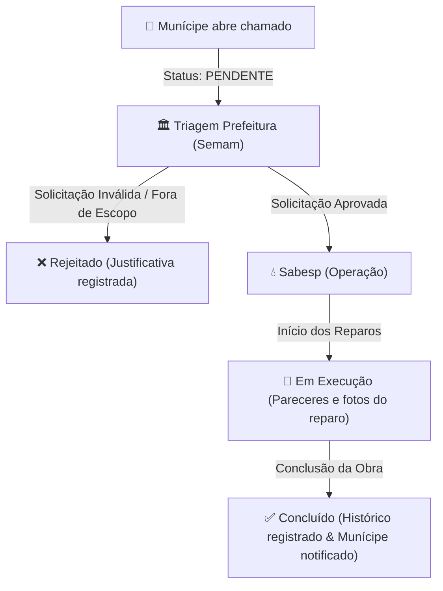
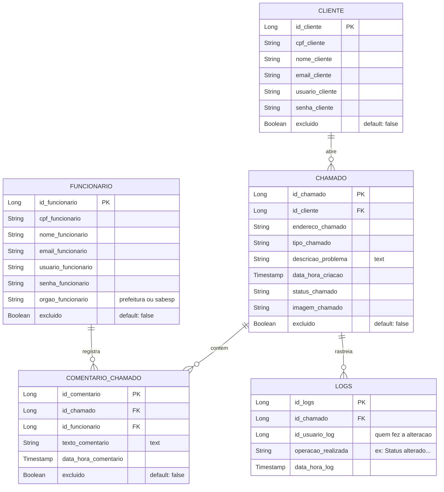

# 💧 Sabesp & Semam - Gestão e Auditoria de Obras na Rede de Esgoto (Santos)

<p align="center">
  
  
  
  
  
  
</p>

Um sistema web desenvolvido para modernizar e conferir transparência ao fluxo de requisições e obras na rede de esgoto do município de Santos. O projeto integra a população, a Secretaria de Meio Ambiente (Semam) e a Sabesp em uma única plataforma centralizada de auditoria, fiscalização e controle operacional.

---

## 📌 Índice

- [Visão Geral](#-visão-geral)
- [Contexto Institucional e Atuação Municipal](#-contexto-institucional-e-atuação-municipal)
- [Ciclo de Vida do Chamado](#-ciclo-de-vida-do-chamado)
- [Funcionalidades por Perfil](#-funcionalidades-por-perfil)
- [Tecnologias Utilizadas](#-tecnologias-utilizadas)
- [Arquitetura e Banco de Dados](#-arquitetura-e-banco-de-dados)
- [Endpoints Principais da API](#-endpoints-principais-da-api)
- [Como Executar o Projeto](#-como-executar-o-projeto)
- [Prototipagem](#-prototipagem)
- [Equipe de Desenvolvimento](#-equipe-de-desenvolvimento)

---

## 🔍 Visão Geral

Historicamente, as solicitações sobre vazamentos e problemas na rede de esgoto dependem de canais fragmentados, dificultando o acompanhamento pelo cidadão e a fiscalização do município sobre os prazos da concessionária.

Esta plataforma soluciona esse gargalo criando uma **esteira de atendimento transparente**:

1. O cidadão registra o chamado com fotos e localização.
2. A Prefeitura (Semam) atua como órgão fiscalizador e regulador, realizando a triagem técnica.
3. A Sabesp recebe as ordens oficiais já auditadas para execução em campo e atualiza o progresso em tempo real.

---

## 🏛️ Contexto Institucional e Atuação Municipal

A cidade de **Santos** possui particularidades geográficas e históricas marcantes, como seus icônicos **canais de drenagem** projetados por Saturnino de Brito e uma orla de grande relevância turística e ambiental. Vazamentos ou anomalias na rede de esgotamento sanitário afetam diretamente a balneabilidade das praias e a saúde pública do município.

### 🌿 Secretaria Municipal de Meio Ambiente, Desenvolvimento Urbano e Sustentabilidade (SEMAM)
- **Missão e Fiscalização:** Órgão municipal responsável pela proteção do ecossistema urbano e controle ambiental, atuando por meio do **DEPCAM** (Departamento de Políticas e Controle Ambiental) e da **SEFISCAM** (Seção de Fiscalização Ambiental).
- **Proteção dos Canais e da Orla:** Atua preventivamente e repressivamente para impedir que efluentes sanitários alcancem as galerias de drenagem de águas pluviais que desembocam nos canais e nas praias.
- **Poder Regulador e Notificação:** Recebe denúncias da população, valida tecnicamente as irregularidades in loco e formaliza as ordens de reparo cobrando prazos de execução da concessionária.

### 💧 Sabesp (Unidade de Negócio Baixada Santista)
- **Operação e Manutenção do Saneamento:** Concessionária responsável pela coleta, transporte e tratamento de esgoto de Santos. Opera estações elevatórias, a Estação de Pré-Condicionamento (EPC) no José Menino e o Emissário Submarino de Santos.
- **Marco Legal do Saneamento (Lei Federal nº 14.026/2020):** Compromisso com metas contínuas de eficiência operacional, universalização do esgotamento sanitário, combate a perdas e redução no tempo de atendimento emergencial a vazamentos.
- **Transparência e Comprovação Técnica:** Na plataforma, a Sabesp registra pareceres técnicos formais, histórico de manutenções e registros fotográficos da obra concluída, garantindo conformidade aos órgãos de controle.

---

## 🔄 Ciclo de Vida do Chamado



### Matriz de Status

| Status        | Descrição                                                                        | Responsável pela Ação |
| :------------ | :------------------------------------------------------------------------------- | :-------------------- |
| `PENDENTE`    | Chamado recém-criado pelo munícipe aguardando análise prévia.                    | Munícipe              |
| `APROVADO`    | Validado tecnicamente pela Semam e liberado como ordem de serviço para a Sabesp. | Prefeitura (Gestão)   |
| `REJEITADO`   | Recusado pela prefeitura com registro formal de justificativa técnica.           | Prefeitura (Gestão)   |
| `EM_EXECUCAO` | Equipe de campo da Sabesp atuando na resolução do problema.                      | Sabesp (Operação)     |
| `CONCLUIDO`   | Obra finalizada com parecer técnico e histórico de intervenções registrado.      | Sabesp (Operação)     |

---

## 👥 Funcionalidades por Perfil

### 📱 Munícipe (Pessoa Comum)
- Cadastro e login na plataforma (`usuario_cliente` / `senha_cliente`).
- Abertura de chamados informando:
  - Endereço da ocorrência;
  - Tipo do problema (ex: vazamento na via, refluxo, rompimento de coletor);
  - Descrição detalhada;
  - Data e hora;
  - Upload de imagem comprobatória (evidência fotográfica).
- Acompanhamento em tempo real do status da solicitação e histórico de chamados próprios.

### 🏛️ Prefeitura / Semam (Gestão e Fiscalização)
- Acompanhamento centralizado de todas as demandas abertas no município.
- **Filtros avançados** para gestão e triagem (por status, tipo de chamado, endereço/bairro e período).
- Validação técnica da solicitação (aprovação ou rejeição formal).
- Emissão oficial de requisições de serviço e auditoria dos prazos da Sabesp.

### 💧 Sabesp (Operação e Execução Técnica)
- Visualização exclusiva de chamados validados pela prefeitura.
- Alteração do status da solicitação conforme avanço da obra (`EM_EXECUCAO`, `CONCLUIDO`).
- Registro de comentários técnicos e histórico de andamento (`ComentarioChamado`) com evidências da intervenção.

---

## 🛠️ Tecnologias Utilizadas

- **Linguagem Principal:** Java (JDK 17+)
- **Framework:** Spring Boot
  - Spring Data JPA (Persistência)
  - Spring Web (RESTful API)
  - Spring Validation (Validações de Regra de Negócio)
- **Mapeamento Objeto-Relacional (ORM):** Hibernate
- **Banco de Dados:** PostgreSQL hospedado via Supabase
- **Prototipagem & UI/UX:** Figma
- **Controle de Versão:** Git & GitHub

---

## 🗄️ Arquitetura e Banco de Dados (Proto SQL)

O modelo de dados foi estruturado para atender aos requisitos de auditoria, rastreabilidade e integridade histórica do setor público:

1. **Soft Delete (`excluido: Boolean, default false`):** Aplicado às entidades cadastrais (`Cliente`, `Funcionario`, `Chamado` e `ComentarioChamado`), garantindo que nenhuma informação seja perdida fisicamente.
2. **Trilha de Auditoria (`Logs`):** Estrutura *append-only* (somente inserção) para registro do histórico de operações realizadas no sistema.



---

## 🔌 Endpoints Principais da API

A documentação interativa com Swagger UI pode ser acessada em:

```
http://localhost:8080/swagger-ui.html
```

| Método  | Rota                             | Descrição                                              | Acesso                 |
| :------ | :------------------------------- | :----------------------------------------------------- | :--------------------- |
| `POST`  | `/api/chamados`                  | Cadastro de novo chamado com upload de evidência       | Munícipe               |
| `GET`   | `/api/chamados`                  | Listagem paginada e filtrada de chamados               | Autenticado            |
| `GET`   | `/api/chamados/{id}`             | Detalhes completos do chamado e histórico de pareceres | Autenticado            |
| `PATCH` | `/api/chamados/{id}/status`      | Alteração do status do chamado (Triagem ou Obra)       | Prefeitura / Sabesp    |
| `POST`  | `/api/chamados/{id}/comentarios` | Inserção de parecer ou comentário técnico              | Prefeitura / Sabesp    |
| `GET`   | `/api/logs`                      | Consulta da trilha de auditoria                        | Prefeitura (Auditoria) |

---

## 🚀 Como Executar o Projeto

### Pré-requisitos

- **Java JDK 17** ou superior instalado
- **Apache Maven 3.8+** instalado (ou utilizar o wrapper `./mvnw`)
- Instância ativa do **PostgreSQL** (ou projeto no **Supabase**)

### Passo a Passo

1. **Clonar o Repositório:**

   ```bash
   git clone https://github.com/CarvalhoNathan/sabesp.git
   cd sabesp
   ```

2. **Configuração do Banco de Dados:**
   No diretório `src/main/resources/application.properties`, configure a string de conexão do Supabase/PostgreSQL:

   ```properties
   spring.datasource.url=jdbc:postgresql://<HOST_SUPABASE>:5432/<DATABASE>
   spring.datasource.username=postgres
   spring.datasource.password=<SUA_SENHA_DO_SUPABASE>

   spring.jpa.hibernate.ddl-auto=update
   spring.jpa.show-sql=true
   spring.jpa.properties.hibernate.dialect=org.hibernate.dialect.PostgreSQLDialect
   ```

3. **Compilar e Executar:**
   ```bash
   mvn spring-boot:run
   ```
   A aplicação estará disponível em `http://localhost:8080`.

---

## 🎨 Prototipagem

O design de interface e a experiência do usuário (UI/UX) foram projetados no Figma com telas específicas para Munícipe, Prefeitura e Sabesp.

> 🔗 **Figma:** _([Projeto Sabesp](https://www.figma.com/design/Tb4SDE9A4oEpLaXfN7aAhe/Projeto-%7C-Sabesp?node-id=0-1&t=yQExxpGpTtvoIWHk-1))_

---

## 👨‍💻 Equipe de Desenvolvimento

Projeto acadêmico desenvolvido por:

- **Nathan Carvalho** - [GitHub](https://github.com/CarvalhoNathan)
- **Andrey Celestino** - [GitHub](https://github.com/DreyCelestino)

---

## 📄 Licença

Este projeto é desenvolvido para fins acadêmicos e educacionais. Consulte o arquivo de licença para maiores detalhes.
