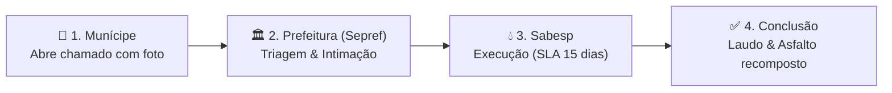
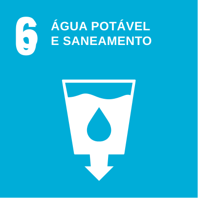
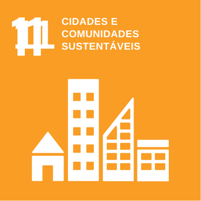
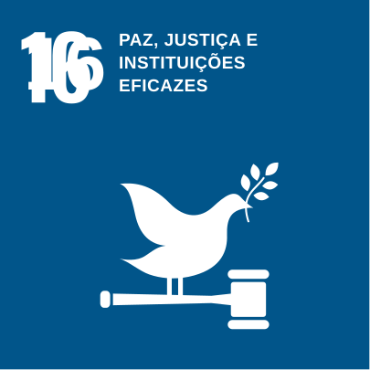

# 💧 Sabesp & Prefeitura de Santos
### Gestão inteligente e auditoria pública na rede de esgoto municipal

<p align="center">
  
  
  
  
  
  
</p>

<p align="center">
  <a href="https://www.figma.com/design/Tb4SDE9A4oEpLaXfN7aAhe/Projeto-%7C-Sabesp?node-id=0-1&t=yQExxpGpTtvoIWHk-1" target="_blank">
    
  </a>
</p>

<p align="center">
  <a href="https://www.figma.com/design/Tb4SDE9A4oEpLaXfN7aAhe/Projeto-%7C-Sabesp?node-id=0-1&t=yQExxpGpTtvoIWHk-1" target="_blank">
    
  </a>
  &nbsp;&nbsp;
  <a href="docs/README.md">
    
  </a>
</p>

> **A Visão:** Transformar a fiscalização urbana do município de Santos substituindo a lentidão e fragmentação da ouvidoria tradicional (onde chamados levam de 30 a 60 dias) por uma **esteira digital única, transparente e auditável**, garantindo o cumprimento do prazo legal de 15 dias da Lei Complementar nº 852/2014 e conectando o munícipe, a Prefeitura (Sepref / Semam / Seserp) e a Sabesp em tempo real.

---

## 📊 O Cenário Real em Números

* **99% de Cobertura Urbana:** Conforme o PMISB (Relatório R4), o desafio de Santos não é a falta de rede, mas a manutenção preventiva e corretiva de uma malha centenária e o fechamento do déficit de 1% em palafitas (como o projeto de 2.500 ligações no **Dique da Vila Gilda**).
* **15 Dias Corridos:** Prazo legal máximo improrrogável estabelecido pela **Lei Complementar nº 852/2014** para a Sabesp concluir reparos na via pública após notificação.
* **30 a 60 Dias na Ouvidoria:** O descompasso da Ouvidoria tradicional (SOM Web / 162), que considera "normal" prazos de até 30 dias enquanto a lei exige solução em 15.
* **+190 Intimações / Mês:** Volume real de intimações e notificações emitidas pelos fiscais técnicos das Prefeituras Regionais (Sepref) para cobrar concessionárias.
* **R$ 818 Mil em Multa:** Sanção histórica aplicada pela SEMAM contra a Sabesp após vazamento que engoliu a Rua Goiás, recurso que hoje alimenta o **Fundo Municipal de Saneamento Básico e Ambiental (FMSBA / Lei nº 4.525/2024)** sob controle do Conselho Municipal (**CMSBS**).

---

## 💎 Os Três Pilares da Solução

| 📱 Para o Munícipe | 🏛️ Para a Prefeitura (Sepref / Semam) | 💧 Para a Sabesp |
| :--- | :--- | :--- |
| **Voz Ativa & Agilidade** | **Controle & Fiscalização** | **Operação & Rastreabilidade** |
| Abertura em segundos com upload de fotos e localização. Acompanhamento transparente do status sem depender de ligações no 162 ou prazos lentos de 60 dias. | Painel centralizado com triagem nas 5 Zonas de Santos, despacho automático de intimações e auditoria do prazo de 15 dias da Lei nº 852/2014. | Recepção de ordens já pré-validadas tecnicamente, registro de pareceres de campo e comprovação fotográfica das intervenções na via. |

### 🔄 Fluxo Operacional Integrado



---

## 🌍 Compromisso com os Objetivos de Desenvolvimento Sustentável (ODS)

Este projeto está alinhado à **Agenda 2030 da Organização das Nações Unidas (ONU)**, contribuindo diretamente para 4 metas globais:

<p align="center">
  
  &nbsp;&nbsp;&nbsp;&nbsp;
  
  &nbsp;&nbsp;&nbsp;&nbsp;
  
  &nbsp;&nbsp;&nbsp;&nbsp;
  
</p>

* **ODS 6 · Água Potável e Saneamento:** Assegurar a disponibilidade e manejo sustentável da água e esgotamento para todos, mitigando a contaminação de canais urbanos e praias de Santos.
* **ODS 9 · Indústria, Inovação e Infraestrutura:** Modernizar a infraestrutura de zeladoria com tecnologia digital e esteira auditada de ordens de serviço.
* **ODS 11 · Cidades e Comunidades Sustentáveis:** Fortalecer a resiliência urbana e a universalização em áreas vulneráveis de palafitas (Dique da Vila Gilda).
* **ODS 16 · Paz, Justiça e Instituições Eficazes:** Assegurar transparência pública, responsabilização regulatória da concessionária e destinação das multas ao fundo municipal (FMSBA).

---

## 🧭 Central de Documentação (Docs Hub)

A documentação é categorizada em **4 pilares temáticos** (consulte também o **[Portal da Documentação (docs/README.md)](docs/README.md)**):

| Categoria | Módulo | Foco & Conteúdo | Link |
| :---: | :--- | :--- | :---: |
| 🏛️ **Institucional** | **Contexto & Legislação** | Diagnóstico real de Santos, caso Rua Goiás, Vila Gilda, FMSBA (Lei 4.525), CMSBS, Sepref/Semam e ODS. | [Explorar →](docs/institucional/contexto-e-legislacao.md) |
| 🏛️ **Institucional** | **Triagem Inteligente** | Árvore de decisão lógica: diferenciação entre esgoto (Sabesp) e águas pluviais/chuva (Prefeitura/Seserp). | [Explorar →](docs/institucional/triagem-inteligente.md) |
| 🏛️ **Institucional** | **Glossário Terminológico** | Dicionário técnico e jurídico de saneamento santista (PV, EEE, EPC, FMSBA, CMSBS) padrão ABNT. | [Explorar →](docs/institucional/glossario.md) |
| 🎨 **Design & UX** | **Personas & Cenários** | Design Thinking: perfis de Dona Helena (Munícipe), Carlos (Fiscal Sepref), Roberto (Sabesp) e Dra. Renata (Semam). | [Explorar →](docs/design-ux/personas-e-cenarios.md) |
| 🎨 **Design & UX** | **Jornada & Arquitetura** | Arquitetura de telas, sitemap completo, wireframe textual e linha do tempo de acompanhamento (Stepper). | [Explorar →](docs/design-ux/jornada-e-ux.md) |
| 🎨 **Design & UX** | **Design System & UI** | Tipografia Montserrat, catálogo de logos vetoriais SVG da Prefeitura de Santos e acesso ao protótipo no Figma. | [Explorar →](docs/design-ux/design-system.md) |
| ⚙️ **Engenharia** | **Requisitos do Sistema** | Matriz MoSCoW (RF01 a RF13, RNF01 a RNF07), regras de negócio e tipologias oficiais do PMISB (Relatório R4). | [Explorar →](docs/engenharia/requisitos-do-sistema.md) |
| ⚙️ **Engenharia** | **Arquitetura & Banco** | Ciclo de vida do chamado, matriz de status, modelo ER (Proto SQL), Soft Delete e Logs imutáveis (*Append-Only*). | [Explorar →](docs/engenharia/arquitetura-e-banco.md) |
| ⚙️ **Engenharia** | **Regras de Negócio & API** | Controle de acesso por papéis (RBAC), validações de domínio e catálogo de rotas RESTful com Swagger UI. | [Explorar →](docs/engenharia/regras-e-api.md) |
| ⚙️ **Engenharia** | **Gestão de Riscos** | Matriz de riscos ISO 31000 / PMBOK: trotes, LGPD, conflitos entre concessionárias e condições de maré. | [Explorar →](docs/engenharia/matriz-de-riscos.md) |
| 🎓 **Acadêmico** | **Metodologia TCC** | Tema, problema de pesquisa, objetivos, justificativa tríplice, metodologia científica e mapeamento para monografia ABNT. | [Explorar →](docs/academico/metodologia-tcc.md) |

---

## 🛠️ Stack Tecnológica

* **Core Backend:** Java 17 • Spring Boot 3 (Data JPA, Security, Web, Validation) • Hibernate • Lombok
* **Banco de Dados & Nuvem:** PostgreSQL • Supabase
* **Design & Experiência:** Figma • Identidade Visual Oficial da Prefeitura de Santos (Montserrat)
* **Padronização:** RESTful API • OpenAPI 3 (Swagger UI) • Git & GitHub

---

## ⚡ Início Rápido (Quickstart)

> ℹ️ **Fase Atual do Projeto (Concepção & Prototipagem):**  
> O projeto encontra-se atualmente na fase de modelagem de requisitos e prototipagem interativa no Figma. Os comandos de execução abaixo referem-se à inicialização do ambiente que será ativada nas **fases 6 e 7** do roadmap.

### 📋 Pré-requisitos de Ambiente (Fases Futuras)
* **Java Development Kit (JDK):** Versão 17 ou superior instalada
* **Apache Maven:** Versão 3.8+ instalada
* **PostgreSQL / Supabase:** Instância relacional ativa
* **Git:** Para versionamento e controle de branches

```bash
# 1. Clone o repositório
git clone https://github.com/CarvalhoNathan/sabesp.git
cd sabesp

# 2. Configure as variáveis de conexão com o Supabase em src/main/resources/application.properties
# spring.datasource.url=jdbc:postgresql://<HOST_SUPABASE>:5432/<DATABASE>
# spring.datasource.username=postgres
# spring.datasource.password=<SUA_SENHA>

# 3. Execute a aplicação (Previsto para Fase 7)
mvn spring-boot:run
```

> Quando ativo, acesse a aplicação em `http://localhost:8080` e a documentação interativa em `http://localhost:8080/swagger-ui.html`.

---

## 🗺️ Roadmap de Entrega

- [x] **Fase 1 · Concepção e Marco Legal:** Diagnóstico municipal, Lei 852/2014, FMSBA (Lei 4.525/2024), PMISB R4 e esteira de valor.
- [x] **Fase 2 · Modelagem e Arquitetura:** Proto SQL, regras de auditoria imutável (Logs), Soft Delete e matriz de requisitos (RF01–RF13).
- [x] **Fase 3 · Identidade Visual:** Padronização dos vetores oficiais `.svg` da Prefeitura de Santos e tipografia Montserrat.
- [x] **Fase 4 · Design Thinking & UX:** Mapeamento de personas, árvore de triagem (esgoto vs. chuva), jornada do usuário e matriz de riscos.
- [ ] **Fase 5 · Prototipagem UI/UX:** Telas interativas no Figma (Munícipe, Fiscalização Municipal e Operação Sabesp).
- [ ] **Fase 6 · Banco em Nuvem:** Implementação do schema relacional no PostgreSQL (Supabase).
- [ ] **Fase 7 · Backend Spring Boot:** Desenvolvimento da API RESTful em Spring Boot 3 com autenticação, validações e RBAC.

---

## 👥 Engenharia & Autoria

Projeto concebido e desenvolvido para o Trabalho de Conclusão de Curso (TCC) por:

<table align="center">
  <tr>
    <td align="center" width="160px">
      <a href="https://github.com/CarvalhoNathan">
        <br />
        <sub><b>Nathan Carvalho</b></sub>
      </a><br />
      <small>Engenharia & Software</small>
    </td>
    <td align="center" width="160px">
      <a href="https://github.com/DreyCelestino">
        <br />
        <sub><b>Andrey Celestino</b></sub>
      </a><br />
      <small>Engenharia & Software</small>
    </td>
  </tr>
</table>

> 🎨 **Protótipo Interativo:** [Acessar Telas no Figma](https://www.figma.com/design/Tb4SDE9A4oEpLaXfN7aAhe/Projeto-%7C-Sabesp?node-id=0-1&t=yQExxpGpTtvoIWHk-1)  
> 🤝 **Padrões de Desenvolvimento & Git:** [Consulte o Guia de Contribuição (CONTRIBUTING.md)](CONTRIBUTING.md)

---

## 📄 Licença

Este projeto é desenvolvido para fins acadêmicos e educacionais sob os termos da **[Licença MIT](LICENSE)**. Consulte o arquivo para maiores detalhes.  
&copy; 2026 Nathan Carvalho & Andrey Celestino.
