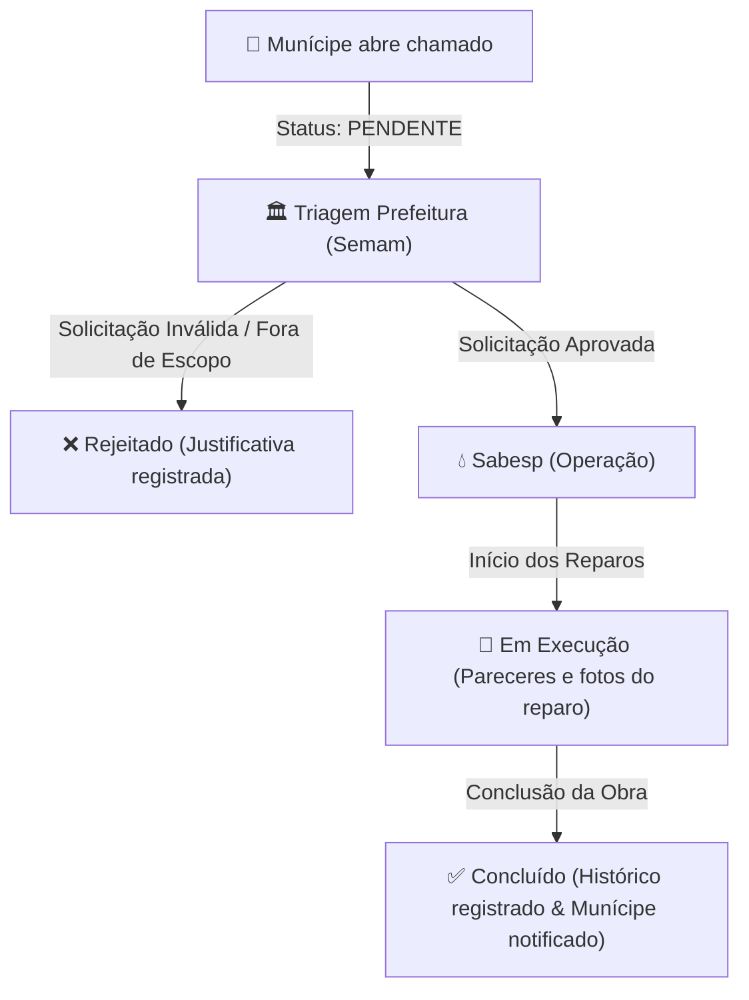
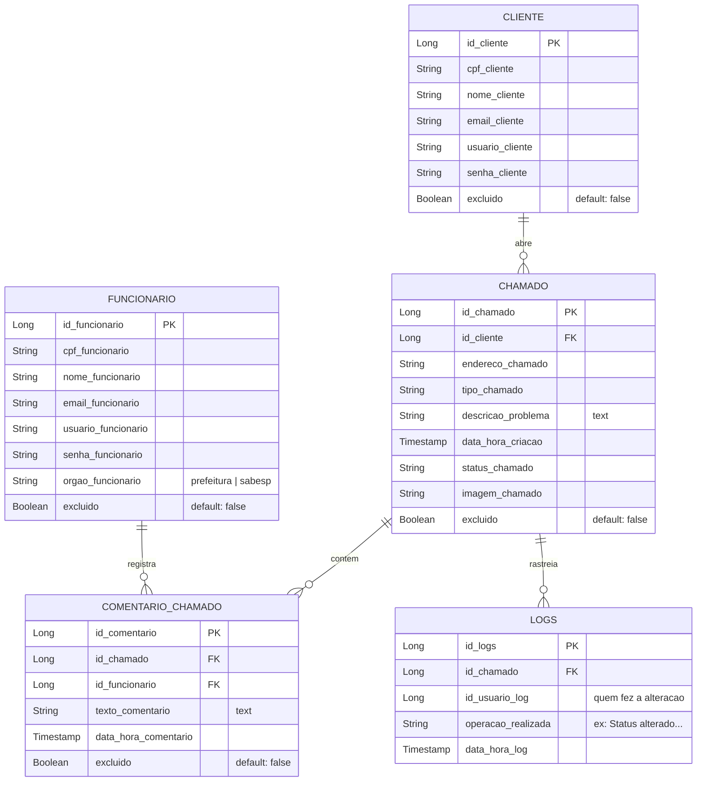

[← Voltar ao Hub Principal](../README.md)

# 🗄️ Arquitetura de Software e Banco de Dados
### Modelagem relacional, padrões de auditoria e estrutura em camadas Spring Boot

> 💡 **Em Resumo:** Este documento apresenta a máquina de estados do chamado, a modelagem relacional de dados (Proto SQL), os padrões de integridade histórica e a separação em camadas adotada na API Java Spring Boot.

---

## 📌 Navegação Rápida
- [Ciclo de Vida do Chamado](#-ciclo-de-vida-do-chamado)
- [Matriz de Status](#-matriz-de-status)
- [Modelo Entidade-Relacionamento (Proto SQL)](#-modelo-entidade-relacionamento-proto-sql)
- [Padrões de Persistência e Integridade](#-padrões-de-persistência-e-integridade)
- [Estrutura de Pacotes do Backend (Spring Boot)](#-estrutura-de-pacotes-do-backend-spring-boot)

---

## 🔄 Ciclo de Vida do Chamado

A tramitação de cada solicitação segue uma esteira de estados auditada que garante o papel fiscalizador da Prefeitura e a execução técnica da Sabesp:



---

## 🚦 Matriz de Status

| Status | Descrição Operacional | Ator Responsável |
| :--- | :--- | :---: |
| `PENDENTE` | Chamado recém-criado pelo munícipe aguardando análise prévia e triagem técnica. | Munícipe |
| `APROVADO` | Validado tecnicamente pela Semam e liberado como ordem de serviço oficial para a Sabesp. | Prefeitura |
| `REJEITADO` | Recusado pela prefeitura com registro formal e obrigatório de justificativa técnica no histórico. | Prefeitura |
| `EM_EXECUCAO` | Equipe de campo da Sabesp atuando na contenção e reparo do problema na via pública. | Sabesp |
| `CONCLUIDO` | Obra finalizada com parecer técnico e comprovação fotográfica da intervenção registrada. | Sabesp |

---

## 🗃️ Modelo Entidade-Relacionamento (Proto SQL)

O modelo foi projetado considerando as necessidades de integridade histórica, normalização e rastreamento de auditoria:



---

## 🛡️ Padrões de Persistência e Integridade

> 💡 **Padrão 1 · Soft Delete (`excluido: Boolean, default false`):**  
> Aplicado em todas as entidades cadastrais (`Cliente`, `Funcionario`, `Chamado` e `ComentarioChamado`). Nenhuma informação pública é apagada fisicamente do banco de dados (`DELETE FROM`). As consultas aplicam filtros automáticos (`WHERE excluido = false`), garantindo a preservação histórica e a recuperação de registros em caso de necessidade de auditoria.

> 🔒 **Padrão 2 · Imutabilidade de Auditoria (`Logs` - Append-Only):**  
> A tabela `Logs` opera estritamente no modelo **Append-Only** (aceita apenas `INSERT` e `SELECT`, sem `UPDATE` ou `DELETE`). Por esse motivo, **não possui o campo `excluido`**, impedindo que operadores ou administradores ocultem alterações de status, garantindo a idoneidade do rastreamento de ações no sistema.

---

## 🏗️ Estrutura de Pacotes do Backend (Spring Boot)

O projeto segue o padrão corporativo de arquitetura em camadas para aplicações Java com Spring Boot:

```text
src/main/java/com/santos/sabesp/
├── config/             # Configurações globais (CORS, Segurança, Swagger/OpenAPI)
├── controller/         # Camada de entrada REST (@RestController com endpoints HTTP)
├── dto/                # Data Transfer Objects (Requests e Responses para desacoplamento de entidades)
├── entity/             # Modelos relacionais JPA com anotações de persistência (@Entity)
├── repository/         # Interfaces de persistência e consultas derivadas (Spring Data JPA)
├── service/            # Regras de negócio, validações e controle de transações (@Service)
└── exception/          # Tratamento global de erros e respostas padronizadas (@ControllerAdvice)
```

---

[← Voltar ao Hub Principal](../README.md)
