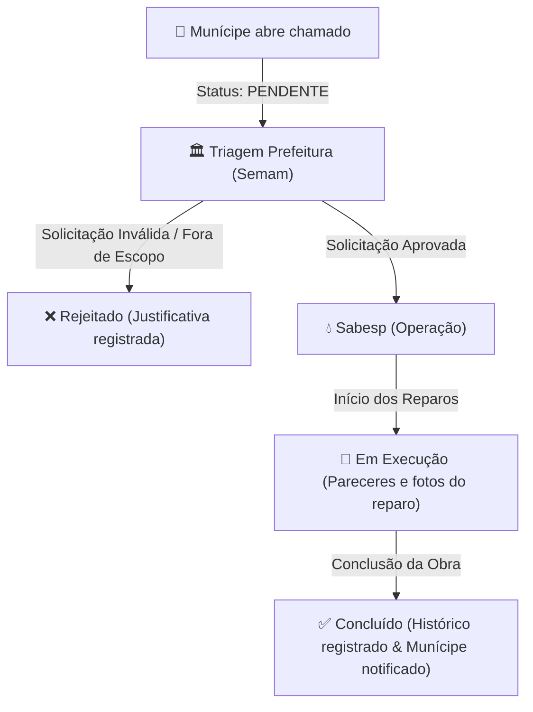
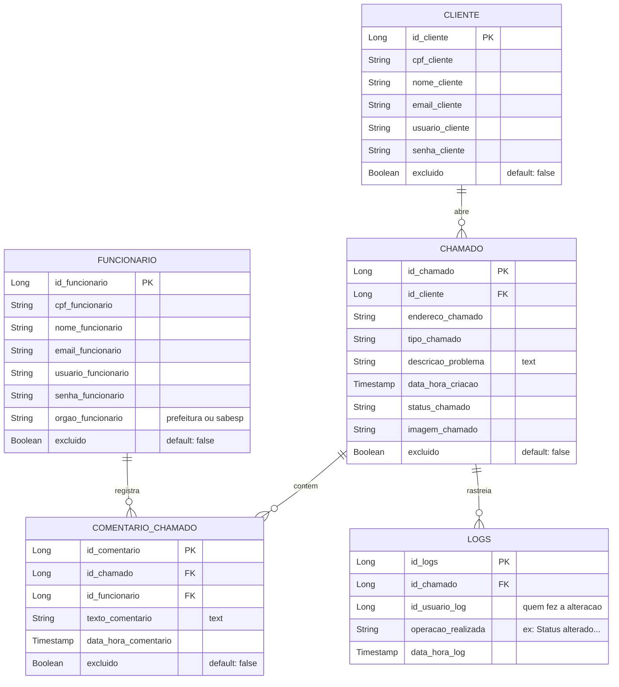

# 🗄️ Arquitetura de Software e Banco de Dados

Este documento descreve a modelagem de dados (Proto SQL), as regras de persistência relacional, os padrões de auditoria e a arquitetura em camadas do backend em Spring Boot.

---

## 📌 Índice
- [Ciclo de Vida do Chamado](#-ciclo-de-vida-do-chamado)
- [Matriz de Status](#-matriz-de-status)
- [Modelo Entidade-Relacionamento (Proto SQL)](#-modelo-entidade-relacionamento-proto-sql)
- [Padrões de Persistência e Integridade](#-padrões-de-persistência-e-integridade)
- [Estrutura de Pacotes do Backend (Spring Boot)](#-estrutura-de-pacotes-do-backend-spring-boot)

---

## 🔄 Ciclo de Vida do Chamado

A tramitação de cada solicitação segue uma esteira de estados auditada que garante o papel fiscalizador da Prefeitura e a execução técnica da Sabesp:



---

## 🚦 Matriz de Status

| Status | Descrição | Responsável pela Ação |
| :--- | :--- | :--- |
| `PENDENTE` | Chamado recém-criado pelo munícipe aguardando análise e triagem prévia. | Munícipe |
| `APROVADO` | Validado tecnicamente pela Semam e liberado como ordem de serviço oficial para a Sabesp. | Prefeitura (Gestão) |
| `REJEITADO` | Recusado pela prefeitura com registro formal e obrigatório de justificativa técnica. | Prefeitura (Gestão) |
| `EM_EXECUCAO` | Equipe de campo da Sabesp atuando na resolução do problema na via pública. | Sabesp (Operação) |
| `CONCLUIDO` | Obra finalizada com parecer técnico e histórico de intervenções registrado. | Sabesp (Operação) |

---

## 🗃️ Modelo Entidade-Relacionamento (Proto SQL)

O modelo foi projetado considerando as necessidades de integridade histórica, relacionamentos relacionais e rastreamento de auditoria:



---

## 🛡️ Padrões de Persistência e Integridade

1. **Soft Delete (`excluido: Boolean, default false`):**
   * Aplicado nas entidades de negócio: `Cliente`, `Funcionario`, `Chamado` e `ComentarioChamado`.
   * Registros nunca são deletados fisicamente do banco de dados (`DELETE FROM`), permitindo a recuperação de registros e a preservação do histórico de dados para auditorias públicas.

2. **Trilha de Auditoria Imutável (`Logs`):**
   * Estrutura estritamente *append-only* (somente operações de `INSERT` e `SELECT`).
   * A tabela `Logs` **não possui o campo `excluido`**, assegurando que os registros de eventos operacionais jamais possam ser ocultados ou apagados, garantindo a conformidade e a segurança do sistema.

---

## 🏗️ Estrutura de Pacotes do Backend (Spring Boot)

O projeto segue a arquitetura em camadas padrão de aplicações corporativas Java com Spring Boot:

```text
src/main/java/com/santos/sabesp/
├── config/             # Configurações globais (CORS, Segurança, Swagger/OpenAPI)
├── controller/         # Camada de entrada REST (@RestController)
├── dto/                # Data Transfer Objects (Requests e Responses para isolamento das entidades)
├── entity/             # Modelos relacionais JPA com anotações de persistência (@Entity)
├── repository/         # Interfaces de persistência e consultas derivadas (Spring Data JPA)
├── service/            # Regras de negócio, validações e controle de transações (@Service)
└── exception/          # Tratamento global de erros e respostas padronizadas (@ControllerAdvice)
```
