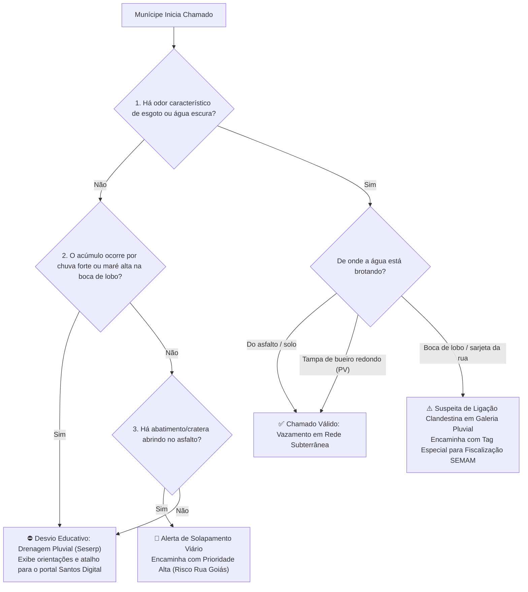

[← Voltar ao Hub Principal](../../README.md)

# 🧠 Triagem Inteligente: Esgoto Sanitário vs. Água Pluvial
### Engenharia de decisão para mitigar chamados inválidos e educar o cidadão

> 💡 **Em Resumo:** Este documento detalha a matriz de discernimento técnico entre a **Rede Coletora de Esgoto (Sabesp)** e o **Sistema de Drenagem de Águas Pluviais (Prefeitura/Seserp/Prodesan)**. O sistema incorpora um assistente guiado de perguntas simples que evita o desvio de demandas e otimiza a triagem fiscalizatória.

---

## 📌 Navegação Rápida
- [O Desafio Histórico da Cidade de Santos](#-o-desafio-histórico-da-cidade-de-santos)
- [Matriz de Competências: Sabesp vs. Prefeitura de Santos](#-matriz-de-competências-sabesp-vs-prefeitura-de-santos)
- [Árvore de Decisão Lógica da Triagem](#-árvore-de-decisão-lógica-da-triagem)
- [Perguntas Guiadas no Formulário do Munícipe](#-perguntas-guiadas-no-formulário-do-munícipe)
- [Tratamento de Anomalias Mistas: Esgoto Clandestino em Canais](#-tratamento-de-anomalias-mistas-esgoto-clandestino-em-canais)

---

## 🏛️ O Desafio Histórico da Cidade de Santos

No início do século XX, o engenheiro **Saturnino de Brito** projetou para Santos o primeiro sistema segregador do Brasil, separando categoricamente:
1. **O Sistema Pluvial (Canais e Galerias):** Coleta exclusivamente a água das chuvas e a escoa para os canais de drenagem que desaguam nas praias ou no estuário.
2. **O Sistema de Esgotamento Sanitário (Sabesp):** Coleta os efluentes domésticos e industriais em tubulações seladas e os encaminha para a Estação de Pré-Condicionamento (EPC) e Emissário Submarino.

> ⚠️ **O Problema Contemporâneo:**  
> A maioria dos munícipes não compreende a diferença estrutural entre esses dois sistemas. Quando veem água acumulada na rua ou calçada, frequentemente registram pedidos de reparo à Sabesp para poças causadas por bocas de lobo entupidas por lixo ou retorno de maré alta.  
> Esse erro gera retrabalho, perda de tempo da fiscalização da **Sepref** e deslocamentos inúteis de caminhões da Sabesp.

---

## ⚖️ Matriz de Competências: Sabesp vs. Prefeitura de Santos

| Aspecto Analisado | Esgotamento Sanitário · SABESP | Drenagem Pluvial · PREFEITURA (Seserp) |
| :--- | :--- | :--- |
| **Elemento Visível** | Poço de Visita (tampa circular pesada de ferro fundido, frequentemente grafada com "SABESP"). | Boca de lobo, grelhas de sarjeta, guias vazadas ou aduelas de canais de drenagem. |
| **Aspecto da Água** | Água turva, cinza ou preta, com espuma residual, graxa e forte odor de gás sulfídrico/esgoto. | Água de chuva barrenta ou turva por terra/areia, sem odor fétido contínuo. |
| **Comportamento** | Mina continuamente do solo ou da tampa mesmo em dias ensolarados e secos. | Ocorre predominantemente durante temporais, maré astronômica alta ou ressacas. |
| **Responsável Legal** | Concessionária Sabesp (sob fiscalização da Semam e prazo de 15 dias da Lei 852/2014). | Secretaria de Serviços Públicos (Seserp) / Prodesan (zeladoria de drenagem). |

---

## 🌳 Árvore de Decisão Lógica da Triagem

O fluxograma abaixo orienta o processamento algorítmico do formulário na abertura do chamado:

---

## 📝 Perguntas Guiadas no Formulário do Munícipe

Para que o cidadão comum responda sem esforço e sem vocabulário técnico, a interface exibe **cards com ilustrações e linguagem direta**:

### Pergunta 1: *"Qual é a aparência e o cheiro do problema?"*
* 🔘 **Opção A (Esgoto):** *"Tem forte mau cheiro de esgoto/fezes e a água sai borbulhando escura ou com espuma."* ➔ *(Pontua para Sabesp)*
* 🔘 **Opção B (Chuva/Lama):** *"É água de chuva acumulada na sarjeta, sem cheiro forte de esgoto."* ➔ *(Alerta de desvio pluvial)*

### Pergunta 2: *"De onde a água está saindo?"*
* 🔘 **Opção A:** *"De uma tampa de ferro fundido no meio da rua ou rachadura no asfalto que está cedendo."* ➔ *(Indica Sabesp / Risco de solapamento)*
* 🔘 **Opção B:** *"Da boca de lobo / grade de metal na sarjeta junto ao meio-fio."* ➔ *(Verifica ligação clandestina ou limpeza de grelha)*

### Pergunta 3: *"O asfalto está afundando ao redor do vazamento?"*
* 🔘 **Sim, o chão está oco ou cedendo:** ➔ *(Dispara flag de urgência imediata para a Seção de Urgência Urbana da Seserp e equipe de plantão da Sabesp)*.
* 🔘 **Não, o pavimento está firme:** ➔ *(Segue fluxo padrão de triagem)*.

---

## 🔍 Tratamento de Anomalias Mistas: Esgoto Clandestino em Canais

Existe uma situação comum na Baixada Santista onde a triagem inteligente opera como **arma de fiscalização ambiental**:

> 🧪 **A Contaminação da Drenagem por Ligações Clandestinas:**  
> Frequentemente, imóveis antigos ou obras irregulares realizam ligações clandestinas de esgoto diretamente na rede de águas pluviais da Prefeitura. Quando a boca de lobo transborda, exala forte odor fétido.

* **Conduta do Sistema:** Se o munícipe relata saída em boca de lobo, mas marca que há forte cheiro de esgoto, o sistema **não descarta o chamado**.
* **Encaminhamento Especial:** A solicitação é classificada com a etiqueta técnica:  
  `[ANOMALIA_MISTA] · Investigação de Esgoto Clandestino / Fiscalização SEMAM`.
* **Ação do Órgão:** A **SEFISCAM** (Seção de Fiscalização Ambiental da SEMAM) utiliza o chamado para realizar teste de corante na rede pluvial e autuar o poluidor, notificando paralelamente a Sabesp para estender a rede coletora na via.

---

[← Voltar ao Hub Principal](../../README.md)